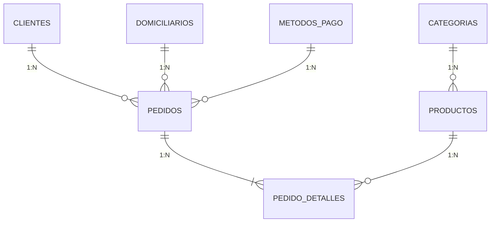

# QuickFood ERP &bull; Sistema de Gestión Empresarial para Dark Kitchen
## Corporación de Estudios Tecnológicos del Norte del Valle — COTECNOVA
### Seminario de Desarrollo de Aplicaciones Web en Laravel con Enfoque RAD (2026)

---

**Asignatura:** Software de Gestión Empresarial (SGE)  
**Proyecto:** QuickFood ERP  
**Giro:** Elaboración, preparación y comercialización de comidas rápidas y bebidas bajo el modelo de *Dark Kitchen* con servicio exclusivo de reparto a domicilio.  
**Repositorio GitHub:** [https://github.com/NiquelAwol/Dark-Kitchen.git](https://github.com/NiquelAwol/Dark-Kitchen.git)  
**Integrantes / Estudiantes:**  
* **Miguel Ángel Ramírez Gutiérrez** &bull; [GitHub: @MiguelAngelRamirezGutierrez](https://github.com/MiguelAngelRamirezGutierrez)  
* **Andrés Felipe Mejía Suaza** &bull; [GitHub: @NiquelAwol](https://github.com/NiquelAwol)  
**Etiqueta Segundo Corte (Tag):** `avance-2`  
**Documento Oficial de Avance 2:** [`docs/avance2/Avance2_QuickFood_Ramirez_Mejia.md`](docs/avance2/Avance2_QuickFood_Ramirez_Mejia.md)  
**Tecnologías:** Laravel 11/12, PHP 8.3/8.5, MySQL 8.4, Docker Desktop, Laravel Sail, Blade, Eloquent ORM, Tailwind CSS y Git.

---

## 1. Resumen Ejecutivo del Proyecto

**QuickFood ERP** es una plataforma web desarrollada a la medida para centralizar la operación interna de una empresa gastronómica de alta demanda. A diferencia de una simple página web comercial o menú digital, este ERP gestiona integralmente el ciclo neurálgico del negocio:

$$\text{Cliente} \longrightarrow \text{Pedido} \longrightarrow \text{Preparación} \longrightarrow \text{Listo (Empaque)} \longrightarrow \text{En camino (Domicilio)} \longrightarrow \text{Entrega y Recaudo}$$

### Ciclo de Estados del Pedido:
1. `Recibido`: Orden registrada con dirección confirmada y productos seleccionados.
2. `Preparando`: Plancha y cocina procesando la comanda.
3. `Listo`: Alimento empacado en bolsa térmica esperando recogida.
4. `En camino`: Domiciliario asignado en ruta de transporte con el producto.
5. `Entregado`: Producto entregado a satisfacción y cobrado al cliente.
6. `Cancelado`: Incidencia o cancelación (con reposición automática de stock).

---

## 2. Requisitos Previos

* **Docker Desktop** (con soporte WSL2 en Windows o Docker nativo en Linux/macOS).
* **Git** instalado.
* Opcional para desarrollo local sin Docker: PHP 8.3+ con extensiones `pdo_mysql`, `curl`, `mbstring`, `xml` y Composer.

---

## 3. Instalación y Puesta en Marcha con Docker y Laravel Sail

### Paso 1: Clonar el repositorio
```bash
git clone https://github.com/NiquelAwol/Dark-Kitchen.git "QuickFood ERP"
cd "QuickFood ERP"
```

### Paso 2: Configurar las Variables de Entorno
Copie el archivo de ejemplo si no existe el `.env`:
```bash
cp .env.example .env
```
Asegúrese de que la sección de base de datos apunte al contenedor de Sail:
```env
DB_CONNECTION=mysql
DB_HOST=mysql
DB_PORT=3306
DB_DATABASE=quickfood_erp
DB_USERNAME=sail
DB_PASSWORD=password
FORWARD_DB_PORT=3306
APP_PORT=80
```

### Paso 3: Iniciar los Contenedores con Laravel Sail
```bash
./vendor/bin/sail up -d
```
*(Los contenedores `quickfooderp-laravel.test-1` y `quickfooderp-mysql-1` iniciarán en segundo plano).*

### Paso 4: Generar la Clave de Aplicación (si es necesario)
```bash
./vendor/bin/sail artisan key:generate
```

### Paso 5: Ejecutar Migraciones y Poblado de Datos (Seeders)
Este comando creará las 7 tablas de negocio con sus restricciones e insertará **mínimo 10 registros coherentes por tabla**:
```bash
./vendor/bin/sail artisan migrate:fresh --seed
```

### Paso 6: Acceso al Sistema
Abra su navegador web e ingrese a:
* **URL del ERP:** [http://localhost](http://localhost) (o [http://127.0.0.1](http://127.0.0.1))
* **Usuario Administrador:** `admin@quickfood.local`
* **Contraseña:** `password123`

---

## 4. Ejecución de Pruebas Automatizadas (PHPUnit)

El proyecto incluye una suite de pruebas de integración y negocio (`tests/Feature/QuickFoodErpTest.php`) que certifica:
1. Existencia de mínimo 10 registros por tabla.
2. Relaciones directas e inversas (`hasMany` y `belongsTo`).
3. Funcionamiento de Scopes (`Producto::activos()`, `Pedido::pendientes()`, etc.).
4. Creación de pedido con cálculo de totales y decremento de inventario.
5. Transición operativa de estados.
6. Respuesta exitosa HTTP 200 de todas las vistas Blade.

Para ejecutar la suite:
```bash
./vendor/bin/sail artisan test
```
**Resultado certificado:**
```text
   PASS  Tests\Unit\ExampleTest
  ✓ that true is true

   PASS  Tests\Feature\QuickFoodErpTest
  ✓ minimum ten records per table                                        3.82s  
  ✓ eloquent relationships work bidirectionally                          0.28s  
  ✓ eloquent scopes filter correctly                                     0.18s  
  ✓ order creation calculates total and decrements stock                 1.19s  
  ✓ order status transitions                                             0.25s  
  ✓ dashboard and views response                                         0.67s  

  Tests:    7 passed (185 assertions)
  Duration: 13.47s
```

---

## 5. Arquitectura del Modelo de Datos (MER)



Para consultar la documentación técnica completa:
* **Análisis de Empresa y Procesos:** [`docs/analisis.md`](docs/analisis.md)
* **Diccionario de Datos:** [`docs/diccionario.md`](docs/diccionario.md)
* **Diagrama MER en Alta Resolución:** [`docs/diagrama_mer.png`](docs/diagrama_mer.png) y [`docs/diagrama_mer.md`](docs/diagrama_mer.md)

---

## 6. Modelos Eloquent y Scopes

* **`Categoria`:** `hasMany(Producto::class)`, scope `scopeActivas($query)`.
* **`Producto`:** `belongsTo(Categoria::class)`, `hasMany(PedidoDetalle::class)`, scopes `scopeActivos($query)`, `scopeConStock($query)`.
* **`Cliente`:** `hasMany(Pedido::class)`, scope `scopeActivos($query)`.
* **`Domiciliario`:** `hasMany(Pedido::class)`, scope `scopeActivos($query)`.
* **`MetodoPago`:** `hasMany(Pedido::class)`, scope `scopeActivos($query)`.
* **`Pedido`:** `belongsTo(Cliente::class)`, `belongsTo(Domiciliario::class)`, `belongsTo(MetodoPago::class)`, `hasMany(PedidoDetalle::class)`, scopes `scopePendientes($query)`, `scopeHoy($query)`, `scopeEntregados($query)`.
* **`PedidoDetalle`:** `belongsTo(Pedido::class)`, `belongsTo(Producto::class)`.

### Eager Loading (`with()`) para Eliminar Consultas N+1
En `PedidoController@index`:
```php
Pedido::with(['cliente', 'domiciliario', 'metodoPago', 'detalles.producto'])
    ->latest()
    ->paginate(10);
```

---

## 7. Guía Paso a Paso para la Sustentación Académica (10 Minutos)

Esta guía describe el guion exacto para presentar y sustentar el proyecto con éxito:

| Minuto | Paso | Qué Demostrar / Qué Decir |
| :---: | :--- | :--- |
| **0 - 1** | **1. Empresa Elegida** | Explicar que se eligió **QuickFood**, una *Dark Kitchen* ficticia de comidas rápidas artesanales enfocada en preparación bajo comanda y servicio a domicilio. |
| **1 - 2** | **2. Problema Identificado** | Cuellos de botella por órdenes en papel, descoordinación en ruta con domiciliarios, pedidos enviados a direcciones obsoletas y falta de control de stock en horas pico. |
| **2 - 3** | **3. Procesos Identificados** | Mostrar el flujo: Cliente ➔ Pedido (Recibido) ➔ Preparación (Cocina) ➔ Empaque (Listo) ➔ Despacho (En camino) ➔ Entrega y Cobro. Mencionando el módulo futuro de compras de insumos. |
| **3 - 4** | **4. Mostrar el MER** | Abrir [`docs/diagrama_mer.png`](docs/diagrama_mer.png) o [`docs/diagrama_mer.md`](docs/diagrama_mer.md). Explicar las 7 entidades de negocio, llaves primarias, foráneas y cardinalidad 1:N. |
| **4 - 5** | **5. Mostrar Migraciones** | Abrir la carpeta `database/migrations/`. Explicar las restricciones `cascadeOnDelete()`, `nullOnDelete()`, tipos de datos `decimal(12,2)` e integridad referencial. |
| **5 - 6** | **6. Mostrar Modelos y Relaciones** | Abrir `app/Models/Pedido.php` y `app/Models/Producto.php`. Enseñar las relaciones `belongsTo()`, `hasMany()`, y los Scopes (`scopePendientes()`, `scopeActivos()`). |
| **6 - 7** | **7. Mostrar Datos en MySQL** | Ejecutar en terminal: `./vendor/bin/sail mysql` y correr `SELECT 'categorias', count(*) FROM categorias ...`. Demostrar que todas las tablas tienen mínimo 10 registros coherentes y reales. |
| **7 - 8** | **8. Listado de Pedidos en el ERP** | Abrir el navegador en `http://localhost/pedidos`. Mostrar la tabla de pedidos, filtros por estado, paginación y explicar cómo el **Eager Loading** (`with(...)`) optimiza las consultas SQL. |
| **8 - 9** | **9. Crear un Pedido** | Ir a `http://localhost/pedidos/create`. Seleccionar cliente (ver cómo se autocompleta la dirección), agregar productos con cantidades (ver cálculo en tiempo real de subtotales y total), guardar la orden y verificar que se descontó el stock. |
| **9 - 9.5**| **10. Transición de Estados** | Abrir la comanda recién creada (`pedidos.show`). Presionar los botones de avance: `Recibido` ➔ `Preparando` ➔ `Listo` ➔ Asignar domiciliario ➔ `En camino` ➔ `Entregado`. |
| **9.5 - 10**| **11. Pruebas Automatizadas** | Correr `./vendor/bin/sail artisan test` en la terminal para demostrar que los 7 tests con 185 aserciones pasan en verde (100% aprobado). |

---

## 8. Comandos Útiles de Laravel Sail

* **Iniciar el entorno:** `./vendor/bin/sail up -d`
* **Detener el entorno:** `./vendor/bin/sail stop`
* **Entrar a la consola MySQL:** `./vendor/bin/sail mysql`
* **Entrar a Tinker:** `./vendor/bin/sail artisan tinker`
* **Ver logs en tiempo real:** `./vendor/bin/sail logs -f`
* **Reiniciar base de datos con datos de prueba:** `./vendor/bin/sail artisan migrate:fresh --seed`
* **Correr pruebas automáticas:** `./vendor/bin/sail artisan test`

---

## 9. Clase 7: Roles, Permisos y CRUD Completo (Spatie, Soft Deletes & Form Requests)

En cumplimiento de la **Guía Completa - Clase 7: Roles, Permisos y CRUD Completo (COTECNOVA 2026)**, se implementó el sistema de control de acceso basado en roles (RBAC), eliminación segura con papelera y validaciones desacopladas:

### 9.1. Roles y Permisos Implementados (`spatie/laravel-permission`)

Se definieron los 3 roles de negocio requeridos en la rúbrica mediante `RolePermissionSeeder`:

| Permiso / Módulo | `admin` 👑 | `almacenista` 📦 | `vendedor` 🛒 | Sin Rol 👤 |
| :--- | :---: | :---: | :---: | :---: |
| **`ver-productos`** | ✅ Sí | ✅ Sí | ✅ Sí (Solo lectura) | ❌ No |
| **`crear-productos`** / **`editar-productos`** | ✅ Sí | ✅ Sí | ❌ No (HTTP 403) | ❌ No |
| **`eliminar-productos`** (Papelera y Restaurar) | ✅ Sí | ❌ No (HTTP 403) | ❌ No (HTTP 403) | ❌ No |
| **`ver-categorias`** | ✅ Sí | ✅ Sí | ❌ No (HTTP 403) | ❌ No |
| **`crear` / `editar` / `eliminar-categorias`** | ✅ Sí | ❌ No (HTTP 403) | ❌ No (HTTP 403) | ❌ No |
| **`ver-pedidos`** / **`crear-pedidos`** | ✅ Sí | ❌ No | ✅ Sí | ❌ No |
| **`ver-clientes`** / **`crear-clientes`** | ✅ Sí | ❌ No | ✅ Sí | ❌ No |
| **Dashboard** | ✅ Completo | ✅ Catálogo | ✅ Operativo | ⚠️ Sin módulos |

#### Usuarios de Prueba para Sustentación
El sistema incluye usuarios preconfigurados listos para probar:
* **Administrador:** `admin@test.com` (Contraseña: `password`) o `admin@quickfood.local` (Contraseña: `password123`)
* **Almacenista:** `almacenista@test.com` (Contraseña: `password`)
* **Vendedor:** `vendedor@test.com` (Contraseña: `password`)

> 💡 **Conmutador Rápido de Roles:** Puede ingresar a `http://localhost:8090/login` donde encontrará botones de 1-clic para cambiar de rol al instante durante la exposición.

---

### 9.2. Eliminación Segura (Soft Deletes) y Papelera de Reciclaje
Implementado en **Productos** y **Categorías**:
* **Migraciones:** Se agregaron las columnas `deleted_at` mediante `$table->softDeletes()` y `$table->dropSoftDeletes()`.
* **Modelos Eloquent:** Integración del trait `use SoftDeletes;` en `app/Models/Producto.php` y `app/Models/Categoria.php`.
* **Relación Segura:** `Producto::categoria()->withTrashed()` permite ver el plato con su categoría aun si esta fue enviada a la papelera.
* **Regla de Integridad de Categorías:** No es posible enviar a papelera una categoría que posea productos asociados (`$categoria->productos()->exists()`).
* **Regla de Restauración de Productos:** Un producto en papelera solo puede restaurarse si su categoría no está eliminada.
* **Interfaz de Papelera:** Vista con contador de ítems en papelera (`$trashedCount`) y botón de **Restaurar** con método `PATCH`.

---

### 9.3. Validaciones con Clases Form Request
La lógica de validación se extrajo de los controladores a clases dedicadas en `app/Http/Requests`:
* `StoreProductoRequest` / `UpdateProductoRequest`: Valida nombres, precios positivos, stock no negativo, existencia de categoría activa (`Rule::exists()->whereNull('deleted_at')`) y normaliza el booleano `estado` mediante `prepareForValidation()`.
* `StoreCategoriaRequest` / `UpdateCategoriaRequest`: Valida unicidad de nombre excluyendo los registros en papelera (`Rule::unique()->withoutTrashed()->ignore(...)`).

---

### 9.4. Protección de Controladores y Vistas
* **HasMiddleware en Controladores:** `ProductoController` y `CategoriaController` implementan `HasMiddleware`, exigiendo permisos específicos de Spatie para cada método (`index`, `create`, `store`, `edit`, `update`, `destroy`, `restore`).
* **Directivas Blade:** Se utilizan `@can('crear-productos')`, `@can('editar-productos')` y `@can('eliminar-productos')` para ocultar o mostrar los botones y accesos según el rol activo.

---

### 9.5. Comandos para Evidencias y Entregables de la Clase 7

| Entregable Solicitado | Comando para Obtener la Evidencia |
| :--- | :--- |
| **1. Tabla roles en MySQL** | `./vendor/bin/sail mysql -e "USE laravel; SELECT * FROM roles;"` |
| **2. Usuario con rol en Tinker** | `./vendor/bin/sail artisan tinker --execute="echo App\Models\User::with('roles')->get()->map(fn(\$u) => \$u->email.' => '.\$u->getRoleNames()->join(', '))->join(PHP_EOL);"` |
| **3. Middleware de permisos** | Inspeccionar líneas 17-25 de `app/Http/Controllers/ProductoController.php`. |
| **4. Mensaje de éxito al eliminar** | Enviar un producto a la papelera desde `http://localhost:8090/productos`. |
| **5. `deleted_at` en MySQL** | `./vendor/bin/sail mysql -e "USE laravel; SELECT id, nombre, deleted_at FROM productos WHERE deleted_at IS NOT NULL;"` |
| **6. Error 403 al entrar sin permiso** | Iniciar sesión como `vendedor@test.com` e intentar ingresar a `http://localhost:8090/categorias`. |

---

### 9.6. Certificación con Pruebas Automatizadas
Para verificar que el sistema cumple con todos los requisitos funcionales:
```bash
./vendor/bin/sail artisan test --filter=Clase7RolesPermisosTest
```
**Resultado:** `7 passed (30 assertions)` ✅

---

## 10. CLASE 9: INTEGRACIÓN DE MÓDULOS, TRANSACCIONES Y DASHBOARD CON KPIs

### 10.1. Arquitectura de Transacciones y Reglas de Negocio
El sistema implementa el servicio `App\Services\SaleService` que integra la lógica comercial del ERP mediante transacciones de base de datos atómicas (`DB::transaction`) y control de concurrencia (`lockForUpdate`):
* **Cálculo de Impuestos:** Cálculo automático de Subtotal, liquidación de IVA colombiano al 19% (`round(subtotal * 0.19, 2)`) y Total a Pagar.
* **Validación de Disponibilidad:** Bloqueo de fila para evitar condiciones de carrera (dos vendedores vendiendo la última unidad simultáneamente). Se valida que el producto esté activo y que `stock >= quantity`.
* **Descuento Atómico de Stock:** Si todos los ítems son válidos, se genera la factura secuencial (`FV-00001`, `FV-00002`...), se crean los registros en `sale_details` y se descuenta el inventario de los productos con `$product->decrement('stock', $quantity)`.
* **Rollback Automático:** Si un solo producto no cuenta con stock o está inactivo, toda la operación se revierte y no se crean facturas huérfanas.
* **Regla Inversa de Anulación:** Al anular una factura (`SaleController@destroy`), se devuelve el stock a los productos con `$detail->product->increment('stock', $detail->quantity)`, se cambia su estado a `anulada` y se envía a la papelera (Soft Delete).
* **Integridad Referencial de Clientes:** No es posible eliminar un cliente si tiene ventas asociadas (`$client->sales()->exists()`).

---

### 10.2. Tablas y Modelos Relacionales (Clase 9)

```
clients (1) ───< sales (N) ───< sale_details (N) >─── (N:1) productos
users   (1) ───< sales (N)
```

1. **`clients`**:
   - `id`, `document_type` (`CC`, `NIT`, `CE`, `PP`), `document_number` (UNIQUE), `name`, `email`, `phone`, `address`, `active` (boolean), `timestamps`, `softDeletes`.
2. **`sales`**:
   - `id`, `invoice_number` (UNIQUE), `client_id` (FK `clients`), `user_id` (FK `users`), `sale_date` (date), `subtotal`, `tax` (19%), `total`, `status` (`pendiente`, `pagada`, `anulada`), `notes`, `timestamps`, `softDeletes`.
3. **`sale_details`**:
   - `id`, `sale_id` (FK `sales`), `product_id` (FK `productos`), `quantity`, `unit_price`, `subtotal`, `timestamps`.

---

### 10.3. Interfaz de Usuario y Formulario Reactivo
* **Ventas (`sales.create`):** Formulario dinámico con JavaScript que permite agregar y remover productos en tiempo real, validando stock disponible y calculando instantáneamente el Subtotal, IVA 19% y Total. En caso de error de validación del servidor, el formulario reconstruye las filas con los valores previos (`old('items')`).
* **Factura Imprimible (`sales.show`):** Comprobante estructurado con desglose de ítems, datos del cliente, vendedor, IVA y totalización, con soporte para impresión física (`window.print()`).
* **Clientes (`clients.index`, `clients.create`, `clients.edit`):** Módulo completo con Soft Deletes, restauración y conteo de ventas asociadas.

---

### 10.4. Dashboard con Indicadores Clave (KPIs) y Top 5
El Dashboard (`DashboardController`) calcula métricas protegidas por roles y permisos:
* **KPI 1: Productos Activos:** Conteo de platos y productos disponibles en catálogo.
* **KPI 2: Stock Crítico (≤ 5):** Alerta de productos próximos a agotarse.
* **KPI 3: Valor del Inventario:** Sumatoria en tiempo real de `precio * stock`.
* **KPI 4: Clientes Activos:** Directorio comercial disponible para facturación.
* **KPI 5: Ventas del Mes:** Total de facturas pagadas y monto acumulado del mes en curso.
* **Top 5 Productos más Vendidos:** Tabla con los 5 productos con mayor rotación y volumen de ventas en el mes actual, agrupados mediante `SaleDetail` y `SUM(quantity)`.

---

### 10.5. Comandos para Obtener las Evidencias de la Clase 9

| Entregable Solicitado | Ruta o Comando para Obtener la Evidencia |
| :--- | :--- |
| **1. Módulo de Clientes (Index)** | Ingresar a `http://localhost:8090/clients`. |
| **2. Formulario de Nueva Venta** | Ingresar a `http://localhost:8090/sales/create` y agregar 2 productos con cantidades para ver el cálculo de IVA (19%) y Total en tiempo real. |
| **3. Venta y Detalle en MySQL** | `docker exec dark-kitchen-main-mysql-1 mysql -u sail -ppassword laravel -e "SELECT id, invoice_number, subtotal, tax, total, status FROM sales; SELECT * FROM sale_details;"` |
| **4. Descuento de Stock en MySQL** | `docker exec dark-kitchen-main-mysql-1 mysql -u sail -ppassword laravel -e "SELECT id, nombre, stock FROM productos LIMIT 5;"` |
| **5. Error por Stock Insuficiente** | Intentar crear una venta con una cantidad superior al stock disponible (el sistema muestra error y no crea la venta). |
| **6. Dashboard con KPIs y Top 5** | Ingresar a `http://localhost:8090/dashboard` como Administrador (`admin@test.com` / `password`). |
| **7. Anulación y Devolución de Stock** | En `http://localhost:8090/sales`, hacer clic en **"Anular"**; el stock se reincorpora al producto y el estado cambia a `anulada`. |
| **8. Control de Acceso por Roles** | Iniciar sesión como `vendedor@test.com` (puede crear ventas pero no ver categorías) o como `almacenista@test.com` (recibe 403 al entrar a `/sales/create`). |

---

### 10.6. Certificación Completa con Pruebas Automatizadas (22 Tests)
Para ejecutar la suite de pruebas de la Clase 9:
```bash
./vendor/bin/sail artisan test --filter=Clase9IntegracionModulosTest
```
**Resultado:** `8 passed (38 assertions)` ✅

Suite completa del proyecto (Clase 7 + Clase 9 + ERP Core):
```bash
./vendor/bin/sail artisan test
```
**Resultado:** `22 passed (4026 assertions)` ✅

---

## 11. Módulo de Compras, Proveedores y Reportes PDF (Clase 10)

En esta fase se consolida el ciclo cerrado de inventario para **QuickFood ERP**, conectando el abastecimiento de materia prima (entradas por órdenes de compra y recepción física) con la comercialización gastronómica (salidas por facturación y ventas). Además, se incorpora la generación de reportes y documentos oficiales en formato PDF con la identidad corporativa de la Dark Kitchen.

### 11.1. Arquitectura del Ciclo Completo de Inventario

```
┌────────────────────────────────────────────────────────────────────────┐
│                   CICLO DE INVENTARIO CERRADO                          │
└────────────────────────────────────────────────────────────────────────┘

  [ Proveedor ]
       │
       ▼ (1) Emisión OC
  ┌──────────────┐     (2) Recepción Física Bodega
  │  purchases   │ ───────────────────────────────────► ┌─────────────┐
  │ (pendiente)  │      (incrementa stock de forma atómica) │  productos  │
  └──────────────┘                                      │ (Inventario)│
                                                        └─────────────┘
                                                               ▲
                                                               │ (3) Facturación Venta
                                                               │ (decrementa stock)
                                                        ┌─────────────┐
                                                        │    sales    │ ◄─── [ Cliente ]
                                                        │ (completada)│
                                                        └─────────────┘
```

### 11.2. Módulo de Proveedores (`providers`)

* **Migración y Estructura:** Tabla `providers` con campos: `document_type`, `document_number` (único), `name`, `contact_name`, `email`, `phone`, `address`, `active` y `SoftDeletes`.
* **Protección de Integridad:** Un proveedor no puede ser eliminado si posee órdenes de compra registradas en el sistema.
* **Form Requests:** `StoreProviderRequest` y `UpdateProviderRequest` con validaciones de unicidad compuesta, formatos y sanitización.
* **Seeder Especializado (`ProviderSeeder`):** 4 proveedores reales adaptados a Dark Kitchen (Carnes Maduradas, Panadería Artesanal, Bebidas y Refrescos, Verduras & Fruver).

### 11.3. Módulo de Compras (`purchases` y `purchase_details`)

#### Máquina de Estados de la Orden de Compra:
```
           ┌──────────────────────┐
           │      pendiente       │  (Al emitir la OC: NO incrementa stock)
           └──────────┬───────────┘
                      │
         ┌────────────┴────────────┐
         │ (Recepción parcial)     │ (Anulación sin entregas)
         ▼                         ▼
  ┌──────────────┐          ┌──────────────┐
  │   parcial    │          │   anulada    │ (No movió stock)
  └──────┬───────┘          └──────────────┘
         │ (Recepción restante)
         ▼
  ┌──────────────┐
  │   recibida   │ (Stock 100% ingresado en bodega)
  └──────────────┘
```

#### Reglas de Negocio Implementadas en `PurchaseService`:
1. **Registro sin Movimiento Prematuro:** La orden nace en estado `pendiente`. El inventario en bodega no cambia hasta la entrega física.
2. **Recepción Atómica con Concurrencia Segura:** La recepción (`receive()`) utiliza `DB::transaction()` y `lockForUpdate()`. Dos almacenistas no pueden colisionar al recibir la misma orden.
3. **Incremento de Stock Proporcional:** Solo las unidades efectivamente recibidas en cada entrega ingresan a la columna `stock` de la tabla `productos`.
4. **Validación de Límite Máximo:** No se permite recibir una cantidad mayor a la pendiente por ítem (`pendingQuantity()`). Cualquier intento arroja `ValidationException`.
5. **No Vacíos ni Negativos:** Las cantidades recibidas deben ser mayores a cero.
6. **Protección de Anulación:** No se puede anular una orden que ya tenga recepciones registradas en bodega (para evitar discrepancias de inventario físico).
7. **No Duplicados:** En el formulario de compra se valida mediante `Rule::distinct` que no se repitan filas con el mismo producto.

### 11.4. Generación de Reportes PDF con DomPDF (`barryvdh/laravel-dompdf`)

Se diseñaron plantillas optimizadas para DomPDF con HTML tabular y estilos CSS compatibles, utilizando la fuente `DejaVu Sans` para soportar acentos y caracteres especiales UTF-8:
* **Orden de Compra (`OC-XXXXX.pdf`):** Accesible en `/purchases/{purchase}/pdf`. Contiene datos del proveedor, dirección de entrega en bodega, desglose de cantidades solicitadas y recibidas, costos unitarios, subtotal, IVA (19%), total y firmas de autorización.
* **Factura Electrónica de Venta (`FV-XXXXX.pdf`):** Accesible en `/sales/{sale}/pdf`. Contiene resolución DIAN, datos del cliente, desglose de ítems vendidos, IVA discriminado, total a pagar y condiciones legales según la Ley 1231 de 2008.

### 11.5. Dashboard y Alertas de Reabastecimiento

* **Nuevos KPIs en Panel Principal:**
  * **Compras del mes:** Cantidad de órdenes emitidas y valor monetario total del mes.
  * **Órdenes por recibir:** Conteo de órdenes en estado `pendiente` o `parcial`.
  * **Proveedores activos:** Número total de proveedores habilitados.
  * **Margen operativo mensual:** Diferencial financiero entre Ventas del mes y Compras del mes.
* **Tabla de Reabastecimiento Crítico:** Detección automática de insumos con stock $\le 5$ unidades, con botón de acceso directo a creación de orden de compra.

### 11.6. Matriz de Roles y Permisos (Spatie RBAC)

| Módulo / Acción | Permiso Spatie | Admin | Almacenista | Vendedor | Cocinero |
| :--- | :--- | :---: | :---: | :---: | :---: |
| Ver Proveedores | `ver-proveedores` | ✅ | ✅ | ❌ | ❌ |
| Crear Proveedores | `crear-proveedores` | ✅ | ✅ | ❌ | ❌ |
| Editar Proveedores | `editar-proveedores` | ✅ | ✅ | ❌ | ❌ |
| Eliminar Proveedores | `eliminar-proveedores` | ✅ | ❌ | ❌ | ❌ |
| Ver Órdenes de Compra | `ver-compras` | ✅ | ✅ | ❌ | ❌ |
| Crear Orden de Compra | `crear-compras` | ✅ | ✅ | ❌ | ❌ |
| Recibir Mercancía en Bodega | `recibir-compras` | ✅ | ✅ | ❌ | ❌ |
| Anular Orden de Compra | `eliminar-compras` | ✅ | ❌ | ❌ | ❌ |

### 11.7. Guía de Verificación y Evidencias (Clase 10)

| Entregable Solicitado | Ruta / Acción para Demostrar en Vivo |
| :--- | :--- |
| **1. Directorio de Proveedores** | Ingresar a `http://localhost:8090/providers` (CRUD completo y filtros). |
| **2. Nueva Orden de Compra** | Entrar a `http://localhost:8090/purchases/create` y seleccionar proveedor y productos. |
| **3. Recepción en Bodega** | En `http://localhost:8090/purchases/{id}`, ingresar cantidad en "Llega ahora" y confirmar entrada a inventario. |
| **4. Descarga PDF Orden de Compra** | Clic en **"Descargar PDF"** en la orden de compra o abrir `http://localhost:8090/purchases/{id}/pdf`. |
| **5. Descarga PDF Factura de Venta** | Clic en **"Descargar PDF"** en cualquier venta o abrir `http://localhost:8090/sales/{id}/pdf`. |
| **6. Dashboard con KPIs y Reorden** | Ingresar a `http://localhost:8090/dashboard` como Administrador o Almacenista. |
| **7. Suite de Pruebas Clase 10** | Ejecutar `./vendor/bin/sail artisan test --filter=Clase10ComprasPdfTest`. |

### 11.8. Certificación con Suite de Pruebas Automatizadas (33 Tests)

Suite específica de Clase 10:
```bash
./vendor/bin/sail artisan test --filter=Clase10ComprasPdfTest
```
**Resultado:** `11 passed (31 assertions)` ✅

Suite completa del proyecto (Clase 7 + Clase 9 + Clase 10 + ERP Core):
```bash
./vendor/bin/sail artisan test
```
**Resultado:** `33 passed (8025 assertions)` ✅

---

## 12. Gestión de Roles, Permisos por Usuario y Rol Activo (Guía Adicional Clase 10)

En esta fase se construye dentro del ERP un módulo de **Configuración de Seguridad Integral** que permite a los administradores gestionar usuarios, roles y permisos en caliente sin tocar código. Se implementa el principio de **Segregación de Funciones (Separation of Duties - SoD)** mediante el concepto de **Rol Activo**, resolviendo el problema de la unión ciega de permisos de Spatie.

### 12.1. Arquitectura de Seguridad y Rol Activo

```
                  ┌──────────────────────────────────────────────┐
                  │              PERMISOS EFECTIVOS              │
                  │   = Rol Activo + Permisos Directos Usuario   │
                  └──────────────────────────────────────────────┘
                                         │
                 ┌───────────────────────┴───────────────────────┐
                 ▼                                               ▼
     ┌───────────────────────┐                       ┌───────────────────────┐
     │   ROL ACTIVO ELEGIDO  │                       │   PERMISOS DIRECTOS   │
     │  (vendedor / almac.)  │                       │   (excepciones indiv) │
     └───────────┬───────────┘                       └───────────┬───────────┘
                 │                                               │
                 └───────────────────────┬───────────────────────┘
                                         ▼
                            ┌─────────────────────────┐
                            │   Gate::before Laravel  │
                            │  (AppServiceProvider)   │
                            └─────────────────────────┘
```

* **Segregación de Funciones:** Si un usuario tiene múltiples roles (ej.: `supervisor@test.com` es Vendedor y Almacenista), al iniciar sesión el sistema le exige seleccionar con cuál trabajar. No puede actuar con ambos a la vez, garantizando que quien emite una compra no se facture a sí mismo como vendedor en la misma sesión.
* **Cambio Dinámico:** Desde el menú de usuario puede alternar su rol de trabajo en cualquier momento (`/rol-activo`).
* **Verificador Central de Spatie Desactivado:** Se configuró `'register_permission_check_method' => false` en `config/permission.php` y se registró un `Gate::before` en `AppServiceProvider` que consulta `$user->hasPermissionInActiveRole($ability)`.
* **Middleware `EnsureActiveRole`:** Obliga a los usuarios con múltiples roles a seleccionar rol de trabajo y expulsa inmediatamente a cualquier usuario cuya cuenta haya sido desactivada.

### 12.2. Usuarios Activos e Inactivos (Trazabilidad)

* **Migración:** Campo `active` (boolean, default true) en tabla `users`.
* **Regla de Negocio:** En lugar de eliminar usuarios (lo que rompería la integridad histórica y referencial de compras y ventas), se desactivan.
* **Control de Acceso:** Un usuario inactivo no puede iniciar sesión. Si es desactivado con sesión abierta, es deslogueado y redirigido al login en su siguiente interacción.

### 12.3. Módulo de Configuración Integral (`/configuracion`)

* **1. Tablero General (`/configuracion`):** Indicadores de usuarios totales, inactivos, con múltiples roles, roles y permisos registrados.
* **2. Administración de Usuarios (`/configuracion/usuarios`):**
  * Alta y edición de credenciales y datos personales.
  * Asignación múltiple de roles.
  * Asignación de permisos directos para excepciones puntuales con indicador visual `por rol: ...` de permisos ya heredados.
  * Botón directo de activación y desactivación (toggle).
* **3. Catálogo y CRUD de Roles (`/configuracion/roles`):**
  * Creación y edición de roles mediante una matriz Módulo $\times$ Acción.
  * Normalización automática a slug (`Jefe de Bodega` $\rightarrow$ `jefe-de-bodega`).
  * Protección: El rol `admin` no se renombra ni se elimina y conserva siempre todos los permisos.
* **4. Matriz Interactiva de Permisos (`/configuracion/permisos`):**
  * Filas: Permisos agrupados por módulo funcional.
  * Columnas: Roles configurados en el ERP.
  * Filtro por módulo específico conservando intactos los permisos de los módulos no visibles gracias al parámetro `visible[]`.
  * Filtro de auditoría **"Ver como usuario"**: Permite inspeccionar qué permisos efectivos tiene un usuario y su procedencia exacta (`rol: vendedor`, `rol: almacenista` o `directo`).
  * Creación dinámica de permisos bajo convención `accion-modulo`.

### 12.4. Reglas de Protección y Seguridad Crítica

1. **Permanencia del Administrador:** Siempre debe existir al menos un usuario activo con el rol `admin`. No se permite desactivar ni quitar el rol al último administrador.
2. **Nadie se auto-desactiva:** Un usuario con rol admin no puede desactivar su propia cuenta.
3. **Inmutabilidad del Super Rol:** El rol `admin` no puede ser eliminado ni renombrado.
4. **Protección de Roles en Uso:** No se puede eliminar un rol que tenga usuarios asignados.
5. **Protección de Permisos en Uso:** No se puede eliminar un permiso que esté asignado a algún rol o como permiso directo a un usuario.

### 12.5. Usuarios y Credenciales de Demostración

| Usuario | Correo | Contraseña | Roles Asignados | Permisos Directos | Particularidad |
| :--- | :--- | :--- | :--- | :--- | :--- |
| **Administrador** | `admin@test.com` | `password` | `admin` | Todos | Acceso total al ERP y a `/configuracion`. |
| **Supervisor** | `supervisor@test.com` | `password` | `vendedor`, `almacenista` | `ver-reportes` | **Dos roles:** exige elegir rol al iniciar sesión. |
| **Vendedor** | `vendedor@test.com` | `password` | `vendedor` | Ninguno | Acceso comercial. Compras le da 403. |
| **Almacenista** | `almacenista@test.com` | `password` | `almacenista` | Ninguno | Acceso a bodega y compras. Ventas le da 403. |

### 12.6. Guía de Verificación y Evidencias de la Guía Adicional

| Entregable Solicitado | Ruta o Acción para Demostrar en Vivo |
| :--- | :--- |
| **1. Selección de Rol Activo** | Iniciar sesión como `supervisor@test.com` (`password`); redirige automáticamente a `/rol-activo`. |
| **2. Segregación de Funciones** | Supervisor en modo vendedor: entra a `/sales` pero recibe 403 en `/purchases`. Cambia a almacenista: entra a `/purchases` pero recibe 403 en `/sales`. |
| **3. Permiso Directo** | Supervisor en cualquiera de sus dos roles puede ver reportes gracias a su permiso directo personal `ver-reportes`. |
| **4. Panel de Configuración** | Ingresar como `admin@test.com` a `http://localhost:8090/configuracion`. |
| **5. CRUD de Usuarios y Roles** | Crear y editar usuarios y roles con asignación interactiva Módulo $\times$ Acción. |
| **6. Matriz de Permisos y Auditoría** | Filtrar por módulo en `/configuracion/permisos` o auditar "Ver como usuario" para ver la procedencia de cada permiso. |
| **7. Protección de Inactivación** | Desactivar a un usuario en `/configuracion/usuarios`: se bloquea su login y si tenía sesión abierta es expulsado inmediatamente. |

### 12.7. Certificación con Suite de Pruebas Automatizadas (47 Tests)

Suite específica de Roles, Permisos y Rol Activo:
```bash
./vendor/bin/sail artisan test --filter=Clase10RolesPermisosAdicionalTest
```
**Resultado:** `14 passed (49 assertions)` ✅

Suite completa del proyecto (Clase 7 + Clase 9 + Clase 10 + Guía Adicional SoD + ERP Core):
```bash
./vendor/bin/sail artisan test
```
**Resultado:** `47 passed (13342 assertions)` ✅

---
*Desarrollado con dedicación y rigurosidad técnica para el Seminario RAD &bull; Cotecnova 2026.*
