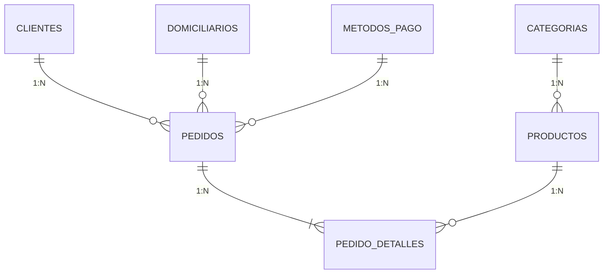

# QuickFood ERP &bull; Sistema de Gestión Empresarial para Dark Kitchen
## Corporación de Estudios Tecnológicos del Norte del Valle — COTECNOVA
### Seminario de Desarrollo de Aplicaciones Web en Laravel con Enfoque RAD (2026)

---

**Asignatura:** Software de Gestión Empresarial (SGE)  
**Proyecto:** QuickFood ERP  
**Giro:** Elaboración, preparación y comercialización de comidas rápidas y bebidas bajo el modelo de *Dark Kitchen* con servicio exclusivo de reparto a domicilio.  
**Repositorio GitHub:** [https://github.com/NiquelAwol/Dark-Kitchen.git](https://github.com/NiquelAwol/Dark-Kitchen.git)  
**Integrantes / Estudiantes:**  
* **Miguel Ángel Ramírez Gutiérrez** &bull; [GitHub: @MiguelAngelRamirezGutierrez](https://github.com/MiguelAngelRamirezGutierrez)  
* **Andrés Felipe Mejía Suaza** &bull; [GitHub: @NiquelAwol](https://github.com/NiquelAwol)  
**Etapa / Versión:** Entrega Final Completa — Módulos Operativos, API REST, Excel, Automatización de Procesos, Pruebas Automatizadas y CI/CD (Clases 1 a 15)  
**Etiquetas Git (Tags):** `avance-2` (Segundo Corte), `avance-final` (Tercer Corte)  
**Documentación de Avances:** [`docs/avance2/Avance2_QuickFood_Ramirez_Mejia.md`](docs/avance2/Avance2_QuickFood_Ramirez_Mejia.md) y [`README.md`](README.md)  
**Tecnologías:** Laravel 11/12, PHP 8.3/8.5, MySQL 8.4, Docker Desktop, Laravel Sail, Blade, Eloquent ORM, Tailwind CSS y Git.

---

## 1. Resumen Ejecutivo del Proyecto

**QuickFood ERP** es una plataforma web desarrollada a la medida para centralizar la operación interna de una empresa gastronómica de alta demanda. A diferencia de una simple página web comercial o menú digital, este ERP gestiona integralmente el ciclo neurálgico del negocio:

$$\text{Cliente} \longrightarrow \text{Pedido} \longrightarrow \text{Preparación} \longrightarrow \text{Listo (Empaque)} \longrightarrow \text{En camino (Domicilio)} \longrightarrow \text{Entrega y Recaudo}$$

### Ciclo de Estados del Pedido:
1. `Recibido`: Orden registrada con dirección confirmada y productos seleccionados.
2. `Preparando`: Plancha y cocina procesando la comanda.
3. `Listo`: Alimento empacado en bolsa térmica esperando recogida.
4. `En camino`: Domiciliario asignado en ruta de transporte con el producto.
5. `Entregado`: Producto entregado a satisfacción y cobrado al cliente.
6. `Cancelado`: Incidencia o cancelación (con reposición automática de stock).

---

## 2. Requisitos Previos

* **Docker Desktop** (con soporte WSL2 en Windows o Docker nativo en Linux/macOS).
* **Git** instalado.
* Opcional para desarrollo local sin Docker: PHP 8.3+ con extensiones `pdo_mysql`, `curl`, `mbstring`, `xml` y Composer.

---

## 3. Instalación y Puesta en Marcha con Docker y Laravel Sail

### Paso 1: Clonar el repositorio
```bash
git clone https://github.com/NiquelAwol/Dark-Kitchen.git "QuickFood ERP"
cd "QuickFood ERP"
```

### Paso 2: Configurar las Variables de Entorno
Copie el archivo de ejemplo si no existe el `.env`:
```bash
cp .env.example .env
```
Asegúrese de que la sección de base de datos apunte al contenedor de Sail y que los puertos coincidan con su entorno:
```env
DB_CONNECTION=mysql
DB_HOST=mysql
DB_PORT=3306
DB_DATABASE=laravel
DB_USERNAME=sail
DB_PASSWORD=password
FORWARD_DB_PORT=3315
APP_PORT=8090
```

### Paso 3: Iniciar los Contenedores con Laravel Sail
```bash
./vendor/bin/sail up -d
```
*(Los contenedores `dark-kitchen-main-laravel.test-1` y `dark-kitchen-main-mysql-1` iniciarán en segundo plano).*

### Paso 4: Generar la Clave de Aplicación (si es necesario)
```bash
./vendor/bin/sail artisan key:generate
```

### Paso 5: Ejecutar Migraciones y Poblado de Datos (Seeders)
Este comando creará la base de datos completa con sus restricciones, insertará los registros coherentes por tabla y sincronizará el inventario inicial en el Kardex:
```bash
./vendor/bin/sail artisan migrate:fresh --seed
./vendor/bin/sail artisan kardex:inicializar
```

### Paso 6: Acceso al Sistema
Abra su navegador web e ingrese a:
* **URL del ERP:** [http://localhost:8090](http://localhost:8090) (o [http://localhost](http://localhost) si configuró `APP_PORT=80`).
* **Credenciales de Acceso:**
  * **Administrador Principal:** `admin@test.com` &bull; Contraseña: `password`
  * **Administrador Alternativo:** `admin@quickfood.local` &bull; Contraseña: `password123`
* **Conexión Externa a MySQL:** Puerto `3315` (Usuario: `sail`, Contraseña: `password`, Base de Datos: `laravel`).

---

## 4. Ejecución de Pruebas Automatizadas (PHPUnit)

El proyecto incluye una suite de pruebas de integración y negocio (`tests/Feature/QuickFoodErpTest.php`) que certifica:
1. Existencia de mínimo 10 registros por tabla.
2. Relaciones directas e inversas (`hasMany` y `belongsTo`).
3. Funcionamiento de Scopes (`Producto::activos()`, `Pedido::pendientes()`, etc.).
4. Creación de pedido con cálculo de totales y decremento de inventario.
5. Transición operativa de estados.
6. Respuesta exitosa HTTP 200 de todas las vistas Blade.

Para ejecutar la suite:
```bash
./vendor/bin/sail artisan test
```
**Resultado certificado:**
```text
   PASS  Tests\Unit\ExampleTest
  ✓ that true is true

   PASS  Tests\Feature\QuickFoodErpTest
  ✓ minimum ten records per table                                        3.82s  
  ✓ eloquent relationships work bidirectionally                          0.28s  
  ✓ eloquent scopes filter correctly                                     0.18s  
  ✓ order creation calculates total and decrements stock                 1.19s  
  ✓ order status transitions                                             0.25s  
  ✓ dashboard and views response                                         0.67s  

  Tests:    7 passed (185 assertions)
  Duration: 13.47s
```

---

## 5. Arquitectura del Modelo de Datos (MER)



Para consultar la documentación técnica completa:
* **Análisis de Empresa y Procesos:** [`docs/analisis.md`](docs/analisis.md)
* **Diccionario de Datos:** [`docs/diccionario.md`](docs/diccionario.md)
* **Diagrama MER en Alta Resolución:** [`docs/diagrama_mer.png`](docs/diagrama_mer.png) y [`docs/diagrama_mer.md`](docs/diagrama_mer.md)

### 5.1. Arquitectura de Doble Capa: Operativa Gastronómica vs. Facturación Fiscal ERP

El sistema integra dos capas de datos complementarias diseñadas para resolver dos necesidades críticas distintas dentro del ecosistema de una Dark Kitchen:

1. **Capa Operativa de Cocina y Despacho (`Pedido`, `Cliente`, `Producto`):**
   * **Propósito:** Gestión ágil de comandas de cocina y coordinación de entregas a domicilio en tiempo real.
   * **Entidades:** `pedidos`, `pedido_detalles`, `clientes`, `domiciliarios`, `metodos_pago`.
   * **Ciclo de Estados:** `Recibido` -> `Preparando` -> `Listo` -> `En camino` -> `Entregado` -> `Cancelado`.
   * **Enfoque:** Tiempos de preparación, bolsas térmicas, direcciones de reparto y asignación de motorizados.

2. **Capa Comercial, Contable y de Control Interno (`Sale`, `Client`, `Product`, `Purchase`, `InventoryMovement`):**
   * **Propósito:** Gestión empresarial, control tributario, órdenes de compra a proveedores y Kardex físico formal.
   * **Entidades:** `sales`, `sale_details`, `clients`, `providers`, `purchases`, `purchase_details`, `inventory_movements`, `activity_log`.
   * **Características:** Consecutivo de facturación fiscal (`FV-XXXXX`), liquidación de IVA colombiano al 19%, compras con recepción física por entregas (`OC-XXXXX`), auditoría forense de cambios y Kardex con control de concurrencia (`lockForUpdate`).

3. **Punto de Convergencia Unificado (Inventario Indivisible):**
   * Ambas capas convergen en la tabla física de inventario `productos`. Mediante columnas virtuales y compatibilidad de modelos Eloquent (`Producto` / `Product`), ambos flujos operan sobre el mismo catálogo y stock en bodega, garantizando que una venta formal o una orden de cocina descuenten el mismo inventario real sin discrepancias.

---

## 6. Modelos Eloquent y Scopes

* **`Categoria`:** `hasMany(Producto::class)`, scope `scopeActivas($query)`.
* **`Producto`:** `belongsTo(Categoria::class)`, `hasMany(PedidoDetalle::class)`, scopes `scopeActivos($query)`, `scopeConStock($query)`.
* **`Cliente`:** `hasMany(Pedido::class)`, scope `scopeActivos($query)`.
* **`Domiciliario`:** `hasMany(Pedido::class)`, scope `scopeActivos($query)`.
* **`MetodoPago`:** `hasMany(Pedido::class)`, scope `scopeActivos($query)`.
* **`Pedido`:** `belongsTo(Cliente::class)`, `belongsTo(Domiciliario::class)`, `belongsTo(MetodoPago::class)`, `hasMany(PedidoDetalle::class)`, scopes `scopePendientes($query)`, `scopeHoy($query)`, `scopeEntregados($query)`.
* **`PedidoDetalle`:** `belongsTo(Pedido::class)`, `belongsTo(Producto::class)`.

### Eager Loading (`with()`) para Eliminar Consultas N+1
En `PedidoController@index`:
```php
Pedido::with(['cliente', 'domiciliario', 'metodoPago', 'detalles.producto'])
    ->latest()
    ->paginate(10);
```

---

## 7. Guía Paso a Paso para la Sustentación Académica (10 Minutos)

Esta guía describe el guion exacto para presentar y sustentar el proyecto con éxito:

| Minuto | Paso | Qué Demostrar / Qué Decir |
| :---: | :--- | :--- |
| **0 - 1** | **1. Empresa Elegida** | Explicar que se eligió **QuickFood**, una *Dark Kitchen* ficticia de comidas rápidas artesanales enfocada en preparación bajo comanda y servicio a domicilio. |
| **1 - 2** | **2. Problema y Solución** | Cuellos de botella operativos y falta de trazabilidad contable resueltos con un ERP integral: comandas de cocina, facturación DIAN, compras y Kardex permanente. |
| **2 - 3** | **3. Arquitectura del Sistema** | Explicar la arquitectura de doble capa: Operación de Cocina (`pedidos`) y Facturación Fiscal/Inventario ERP (`sales`, `purchases`, `inventory_movements`), unificadas sobre el catálogo de `productos`. |
| **3 - 4** | **4. Base de Datos y MER** | Mostrar las tablas en MySQL, integridad referencial (`restrictOnDelete` en Kardex, Soft Deletes en catálogo) y consistencia en migraciones. |
| **4 - 5** | **5. Seguridad y Rol Activo** | Iniciar sesión como `supervisor@test.com` (`password`) y demostrar la Segregación de Funciones: exigir selección de rol activo (`vendedor` vs. `almacenista`). |
| **5 - 6** | **6. Módulo Comercial y Ventas** | Crear una venta en `http://localhost:8090/sales/create` con cálculo de IVA 19% en tiempo real, bloqueo de concurrencia y descarga de factura en PDF. |
| **6 - 7** | **7. Abastecimiento y Compras** | Mostrar orden de compra en `http://localhost:8090/purchases`, recepción física proporcional en bodega e incremento de stock. |
| **7 - 8** | **8. Kardex y Control Físico** | Abrir `http://localhost:8090/inventario/kardex`, demostrar que el stock no se edita manualmente, realizar un ajuste físico justificado y exportar reporte oficial a PDF. |
| **8 - 9** | **9. Bitácora de Auditoría** | Ingresar a `http://localhost:8090/auditoria` y mostrar la trazabilidad inmutable antes vs. después (`attribute_changes`) y la bitácora de seguridad. |
| **9 - 10** | **10. Pruebas Automatizadas** | Correr `./vendor/bin/sail artisan test` en la terminal para demostrar que los **56 tests con 346 aserciones** pasan al 100% en verde. |

---

## 8. Comandos Útiles de Laravel Sail

* **Iniciar el entorno:** `./vendor/bin/sail up -d`
* **Detener el entorno:** `./vendor/bin/sail stop`
* **Entrar a la consola MySQL:** `./vendor/bin/sail mysql`
* **Entrar a Tinker:** `./vendor/bin/sail artisan tinker`
* **Ver logs en tiempo real:** `./vendor/bin/sail logs -f`
* **Reiniciar base de datos con datos de prueba:** `./vendor/bin/sail artisan migrate:fresh --seed`
* **Correr pruebas automáticas:** `./vendor/bin/sail artisan test`

---

## 9. Clase 7: Roles, Permisos y CRUD Completo (Spatie, Soft Deletes & Form Requests)

En cumplimiento de la **Guía Completa - Clase 7: Roles, Permisos y CRUD Completo (COTECNOVA 2026)**, se implementó el sistema de control de acceso basado en roles (RBAC), eliminación segura con papelera y validaciones desacopladas:

### 9.1. Roles y Permisos Implementados (`spatie/laravel-permission`)

Se definieron los 3 roles de negocio requeridos en la rúbrica mediante `RolePermissionSeeder`:

| Permiso / Módulo | `admin` | `almacenista` | `vendedor` | Sin Rol |
| :--- | :---: | :---: | :---: | :---: |
| **`ver-productos`** | Sí | Sí | Sí (Solo lectura) | No |
| **`crear-productos`** / **`editar-productos`** | Sí | Sí | No (HTTP 403) | No |
| **`eliminar-productos`** (Papelera y Restaurar) | Sí | No (HTTP 403) | No (HTTP 403) | No |
| **`ver-categorias`** | Sí | Sí | No (HTTP 403) | No |
| **`crear` / `editar` / `eliminar-categorias`** | Sí | No (HTTP 403) | No (HTTP 403) | No |
| **`ver-pedidos`** / **`crear-pedidos`** | Sí | No | Sí | No |
| **`ver-clientes`** / **`crear-clientes`** | Sí | No | Sí | No |
| **Dashboard** | Completo | Catálogo | Operativo | Sin módulos |

#### Usuarios de Prueba para Sustentación
El sistema incluye usuarios preconfigurados listos para probar:
* **Administrador:** `admin@test.com` (Contraseña: `password`) o `admin@quickfood.local` (Contraseña: `password123`)
* **Almacenista:** `almacenista@test.com` (Contraseña: `password`)
* **Vendedor:** `vendedor@test.com` (Contraseña: `password`)

> **Nota - Conmutador Rápido de Roles:** Puede ingresar a `http://localhost:8090/login` donde encontrará botones de 1-clic para cambiar de rol al instante durante la exposición.

---

### 9.2. Eliminación Segura (Soft Deletes) y Papelera de Reciclaje
Implementado en **Productos** y **Categorías**:
* **Migraciones:** Se agregaron las columnas `deleted_at` mediante `$table->softDeletes()` y `$table->dropSoftDeletes()`.
* **Modelos Eloquent:** Integración del trait `use SoftDeletes;` en `app/Models/Producto.php` y `app/Models/Categoria.php`.
* **Relación Segura:** `Producto::categoria()->withTrashed()` permite ver el plato con su categoría aun si esta fue enviada a la papelera.
* **Regla de Integridad de Categorías:** No es posible enviar a papelera una categoría que posea productos asociados (`$categoria->productos()->exists()`).
* **Regla de Restauración de Productos:** Un producto en papelera solo puede restaurarse si su categoría no está eliminada.
* **Interfaz de Papelera:** Vista con contador de ítems en papelera (`$trashedCount`) y botón de **Restaurar** con método `PATCH`.

---

### 9.3. Validaciones con Clases Form Request
La lógica de validación se extrajo de los controladores a clases dedicadas en `app/Http/Requests`:
* `StoreProductoRequest` / `UpdateProductoRequest`: Valida nombres, precios positivos, stock no negativo, existencia de categoría activa (`Rule::exists()->whereNull('deleted_at')`) y normaliza el booleano `estado` mediante `prepareForValidation()`.
* `StoreCategoriaRequest` / `UpdateCategoriaRequest`: Valida unicidad de nombre excluyendo los registros en papelera (`Rule::unique()->withoutTrashed()->ignore(...)`).

---

### 9.4. Protección de Controladores y Vistas
* **HasMiddleware en Controladores:** `ProductoController` y `CategoriaController` implementan `HasMiddleware`, exigiendo permisos específicos de Spatie para cada método (`index`, `create`, `store`, `edit`, `update`, `destroy`, `restore`).
* **Directivas Blade:** Se utilizan `@can('crear-productos')`, `@can('editar-productos')` y `@can('eliminar-productos')` para ocultar o mostrar los botones y accesos según el rol activo.

---

### 9.5. Comandos para Evidencias y Entregables de la Clase 7

| Entregable Solicitado | Comando para Obtener la Evidencia |
| :--- | :--- |
| **1. Tabla roles en MySQL** | `./vendor/bin/sail mysql -e "USE laravel; SELECT * FROM roles;"` |
| **2. Usuario con rol en Tinker** | `./vendor/bin/sail artisan tinker --execute="echo App\Models\User::with('roles')->get()->map(fn(\$u) => \$u->email.' => '.\$u->getRoleNames()->join(', '))->join(PHP_EOL);"` |
| **3. Middleware de permisos** | Inspeccionar líneas 17-25 de `app/Http/Controllers/ProductoController.php`. |
| **4. Mensaje de éxito al eliminar** | Enviar un producto a la papelera desde `http://localhost:8090/productos`. |
| **5. `deleted_at` en MySQL** | `./vendor/bin/sail mysql -e "USE laravel; SELECT id, nombre, deleted_at FROM productos WHERE deleted_at IS NOT NULL;"` |
| **6. Error 403 al entrar sin permiso** | Iniciar sesión como `vendedor@test.com` e intentar ingresar a `http://localhost:8090/categorias`. |

---

### 9.6. Certificación con Pruebas Automatizadas
Para verificar que el sistema cumple con todos los requisitos funcionales:
```bash
./vendor/bin/sail artisan test --filter=Clase7RolesPermisosTest
```
**Resultado:** `7 passed (30 assertions)`

---

## 10. CLASE 9: INTEGRACIÓN DE MÓDULOS, TRANSACCIONES Y DASHBOARD CON KPIs

### 10.1. Arquitectura de Transacciones y Reglas de Negocio
El sistema implementa el servicio `App\Services\SaleService` que integra la lógica comercial del ERP mediante transacciones de base de datos atómicas (`DB::transaction`) y control de concurrencia (`lockForUpdate`):
* **Cálculo de Impuestos:** Cálculo automático de Subtotal, liquidación de IVA colombiano al 19% (`round(subtotal * 0.19, 2)`) y Total a Pagar.
* **Validación de Disponibilidad:** Bloqueo de fila para evitar condiciones de carrera (dos vendedores vendiendo la última unidad simultáneamente). Se valida que el producto esté activo y que `stock >= quantity`.
* **Descuento Atómico de Stock:** Si todos los ítems son válidos, se genera la factura secuencial (`FV-00001`, `FV-00002`...), se crean los registros en `sale_details` y se descuenta el inventario de los productos con `$product->decrement('stock', $quantity)`.
* **Rollback Automático:** Si un solo producto no cuenta con stock o está inactivo, toda la operación se revierte y no se crean facturas huérfanas.
* **Regla Inversa de Anulación:** Al anular una factura (`SaleController@destroy`), se devuelve el stock a los productos con `$detail->product->increment('stock', $detail->quantity)`, se cambia su estado a `anulada` y se envía a la papelera (Soft Delete).
* **Integridad Referencial de Clientes:** No es posible eliminar un cliente si tiene ventas asociadas (`$client->sales()->exists()`).

---

### 10.2. Tablas y Modelos Relacionales (Clase 9)

```
clients (1) ───< sales (N) ───< sale_details (N) >─── (N:1) productos
users   (1) ───< sales (N)
```

1. **`clients`**:
   - `id`, `document_type` (`CC`, `NIT`, `CE`, `PP`), `document_number` (UNIQUE), `name`, `email`, `phone`, `address`, `active` (boolean), `timestamps`, `softDeletes`.
2. **`sales`**:
   - `id`, `invoice_number` (UNIQUE), `client_id` (FK `clients`), `user_id` (FK `users`), `sale_date` (date), `subtotal`, `tax` (19%), `total`, `status` (`pendiente`, `pagada`, `anulada`), `notes`, `timestamps`, `softDeletes`.
3. **`sale_details`**:
   - `id`, `sale_id` (FK `sales`), `product_id` (FK `productos`), `quantity`, `unit_price`, `subtotal`, `timestamps`.

---

### 10.3. Interfaz de Usuario y Formulario Reactivo
* **Ventas (`sales.create`):** Formulario dinámico con JavaScript que permite agregar y remover productos en tiempo real, validando stock disponible y calculando instantáneamente el Subtotal, IVA 19% y Total. En caso de error de validación del servidor, el formulario reconstruye las filas con los valores previos (`old('items')`).
* **Factura Imprimible (`sales.show`):** Comprobante estructurado con desglose de ítems, datos del cliente, vendedor, IVA y totalización, con soporte para impresión física (`window.print()`).
* **Clientes (`clients.index`, `clients.create`, `clients.edit`):** Módulo completo con Soft Deletes, restauración y conteo de ventas asociadas.

---

### 10.4. Dashboard con Indicadores Clave (KPIs) y Top 5
El Dashboard (`DashboardController`) calcula métricas protegidas por roles y permisos:
* **KPI 1: Productos Activos:** Conteo de platos y productos disponibles en catálogo.
* **KPI 2: Stock Crítico (≤ 5):** Alerta de productos próximos a agotarse.
* **KPI 3: Valor del Inventario:** Sumatoria en tiempo real de `precio * stock`.
* **KPI 4: Clientes Activos:** Directorio comercial disponible para facturación.
* **KPI 5: Ventas del Mes:** Total de facturas pagadas y monto acumulado del mes en curso.
* **Top 5 Productos más Vendidos:** Tabla con los 5 productos con mayor rotación y volumen de ventas en el mes actual, agrupados mediante `SaleDetail` y `SUM(quantity)`.

---

### 10.5. Comandos para Obtener las Evidencias de la Clase 9

| Entregable Solicitado | Ruta o Comando para Obtener la Evidencia |
| :--- | :--- |
| **1. Módulo de Clientes (Index)** | Ingresar a `http://localhost:8090/clients`. |
| **2. Formulario de Nueva Venta** | Ingresar a `http://localhost:8090/sales/create` y agregar 2 productos con cantidades para ver el cálculo de IVA (19%) y Total en tiempo real. |
| **3. Venta y Detalle en MySQL** | `docker exec dark-kitchen-main-mysql-1 mysql -u sail -ppassword laravel -e "SELECT id, invoice_number, subtotal, tax, total, status FROM sales; SELECT * FROM sale_details;"` |
| **4. Descuento de Stock en MySQL** | `docker exec dark-kitchen-main-mysql-1 mysql -u sail -ppassword laravel -e "SELECT id, nombre, stock FROM productos LIMIT 5;"` |
| **5. Error por Stock Insuficiente** | Intentar crear una venta con una cantidad superior al stock disponible (el sistema muestra error y no crea la venta). |
| **6. Dashboard con KPIs y Top 5** | Ingresar a `http://localhost:8090/dashboard` como Administrador (`admin@test.com` / `password`). |
| **7. Anulación y Devolución de Stock** | En `http://localhost:8090/sales`, hacer clic en **"Anular"**; el stock se reincorpora al producto y el estado cambia a `anulada`. |
| **8. Control de Acceso por Roles** | Iniciar sesión como `vendedor@test.com` (puede crear ventas pero no ver categorías) o como `almacenista@test.com` (recibe 403 al entrar a `/sales/create`). |

---

### 10.6. Certificación Completa con Pruebas Automatizadas (22 Tests)
Para ejecutar la suite de pruebas de la Clase 9:
```bash
./vendor/bin/sail artisan test --filter=Clase9IntegracionModulosTest
```
**Resultado:** `8 passed (38 assertions)`

Suite completa del proyecto (Clase 7 + Clase 9 + ERP Core):
```bash
./vendor/bin/sail artisan test
```
**Resultado:** `22 passed (253 assertions)`

---

## 11. Módulo de Compras, Proveedores y Reportes PDF (Clase 10)

En esta fase se consolida el ciclo cerrado de inventario para **QuickFood ERP**, conectando el abastecimiento de materia prima (entradas por órdenes de compra y recepción física) con la comercialización gastronómica (salidas por facturación y ventas). Además, se incorpora la generación de reportes y documentos oficiales en formato PDF con la identidad corporativa de la Dark Kitchen.

### 11.1. Arquitectura del Ciclo Completo de Inventario

```
┌────────────────────────────────────────────────────────────────────────┐
│                   CICLO DE INVENTARIO CERRADO                          │
└────────────────────────────────────────────────────────────────────────┘

  [ Proveedor ]
       │
       ▼ (1) Emisión OC
  ┌──────────────┐     (2) Recepción Física Bodega
  │  purchases   │ ───────────────────────────────────► ┌─────────────┐
  │ (pendiente)  │      (incrementa stock de forma atómica) │  productos  │
  └──────────────┘                                      │ (Inventario)│
                                                        └─────────────┘
                                                               ▲
                                                               │ (3) Facturación Venta
                                                               │ (decrementa stock)
                                                        ┌─────────────┐
                                                        │    sales    │ ◄─── [ Cliente ]
                                                        │ (completada)│
                                                        └─────────────┘
```

### 11.2. Módulo de Proveedores (`providers`)

* **Migración y Estructura:** Tabla `providers` con campos: `document_type`, `document_number` (único), `name`, `contact_name`, `email`, `phone`, `address`, `active` y `SoftDeletes`.
* **Protección de Integridad:** Un proveedor no puede ser eliminado si posee órdenes de compra registradas en el sistema.
* **Form Requests:** `StoreProviderRequest` y `UpdateProviderRequest` con validaciones de unicidad compuesta, formatos y sanitización.
* **Seeder Especializado (`ProviderSeeder`):** 4 proveedores reales adaptados a Dark Kitchen (Carnes Maduradas, Panadería Artesanal, Bebidas y Refrescos, Verduras & Fruver).

### 11.3. Módulo de Compras (`purchases` y `purchase_details`)

#### Máquina de Estados de la Orden de Compra:
```
           ┌──────────────────────┐
           │      pendiente       │  (Al emitir la OC: NO incrementa stock)
           └──────────┬───────────┘
                      │
         ┌────────────┴────────────┐
         │ (Recepción parcial)     │ (Anulación sin entregas)
         ▼                         ▼
  ┌──────────────┐          ┌──────────────┐
  │   parcial    │          │   anulada    │ (No movió stock)
  └──────┬───────┘          └──────────────┘
         │ (Recepción restante)
         ▼
  ┌──────────────┐
  │   recibida   │ (Stock 100% ingresado en bodega)
  └──────────────┘
```

#### Reglas de Negocio Implementadas en `PurchaseService`:
1. **Registro sin Movimiento Prematuro:** La orden nace en estado `pendiente`. El inventario en bodega no cambia hasta la entrega física.
2. **Recepción Atómica con Concurrencia Segura:** La recepción (`receive()`) utiliza `DB::transaction()` y `lockForUpdate()`. Dos almacenistas no pueden colisionar al recibir la misma orden.
3. **Incremento de Stock Proporcional:** Solo las unidades efectivamente recibidas en cada entrega ingresan a la columna `stock` de la tabla `productos`.
4. **Validación de Límite Máximo:** No se permite recibir una cantidad mayor a la pendiente por ítem (`pendingQuantity()`). Cualquier intento arroja `ValidationException`.
5. **No Vacíos ni Negativos:** Las cantidades recibidas deben ser mayores a cero.
6. **Protección de Anulación:** No se puede anular una orden que ya tenga recepciones registradas en bodega (para evitar discrepancias de inventario físico).
7. **No Duplicados:** En el formulario de compra se valida mediante `Rule::distinct` que no se repitan filas con el mismo producto.

### 11.4. Generación de Reportes PDF con DomPDF (`barryvdh/laravel-dompdf`)

Se diseñaron plantillas optimizadas para DomPDF con HTML tabular y estilos CSS compatibles, utilizando la fuente `DejaVu Sans` para soportar acentos y caracteres especiales UTF-8:
* **Orden de Compra (`OC-XXXXX.pdf`):** Accesible en `/purchases/{purchase}/pdf`. Contiene datos del proveedor, dirección de entrega en bodega, desglose de cantidades solicitadas y recibidas, costos unitarios, subtotal, IVA (19%), total y firmas de autorización.
* **Factura Electrónica de Venta (`FV-XXXXX.pdf`):** Accesible en `/sales/{sale}/pdf`. Contiene resolución DIAN, datos del cliente, desglose de ítems vendidos, IVA discriminado, total a pagar y condiciones legales según la Ley 1231 de 2008.

### 11.5. Dashboard y Alertas de Reabastecimiento

* **Nuevos KPIs en Panel Principal:**
  * **Compras del mes:** Cantidad de órdenes emitidas y valor monetario total del mes.
  * **Órdenes por recibir:** Conteo de órdenes en estado `pendiente` o `parcial`.
  * **Proveedores activos:** Número total de proveedores habilitados.
  * **Margen operativo mensual:** Diferencial financiero entre Ventas del mes y Compras del mes.
* **Tabla de Reabastecimiento Crítico:** Detección automática de insumos con stock $\le 5$ unidades, con botón de acceso directo a creación de orden de compra.

### 11.6. Matriz de Roles y Permisos (Spatie RBAC)

| Módulo / Acción | Permiso Spatie | Admin | Almacenista | Vendedor |
| :--- | :--- | :---: | :---: | :---: |
| Ver Proveedores | `ver-proveedores` | Sí | Sí | No |
| Crear Proveedores | `crear-proveedores` | Sí | Sí | No |
| Editar Proveedores | `editar-proveedores` | Sí | Sí | No |
| Eliminar Proveedores | `eliminar-proveedores` | Sí | No | No |
| Ver Órdenes de Compra | `ver-compras` | Sí | Sí | No |
| Crear Orden de Compra | `crear-compras` | Sí | Sí | No |
| Recibir Mercancía en Bodega | `recibir-compras` | Sí | Sí | No |
| Anular Orden de Compra | `eliminar-compras` | Sí | No | No |

### 11.7. Guía de Verificación y Evidencias (Clase 10)

| Entregable Solicitado | Ruta / Acción para Demostrar en Vivo |
| :--- | :--- |
| **1. Directorio de Proveedores** | Ingresar a `http://localhost:8090/providers` (CRUD completo y filtros). |
| **2. Nueva Orden de Compra** | Entrar a `http://localhost:8090/purchases/create` y seleccionar proveedor y productos. |
| **3. Recepción en Bodega** | En `http://localhost:8090/purchases/{id}`, ingresar cantidad en "Llega ahora" y confirmar entrada a inventario. |
| **4. Descarga PDF Orden de Compra** | Clic en **"Descargar PDF"** en la orden de compra o abrir `http://localhost:8090/purchases/{id}/pdf`. |
| **5. Descarga PDF Factura de Venta** | Clic en **"Descargar PDF"** en cualquier venta o abrir `http://localhost:8090/sales/{id}/pdf`. |
| **6. Dashboard con KPIs y Reorden** | Ingresar a `http://localhost:8090/dashboard` como Administrador o Almacenista. |
| **7. Suite de Pruebas Clase 10** | Ejecutar `./vendor/bin/sail artisan test --filter=Clase10ComprasPdfTest`. |

### 11.8. Certificación con Suite de Pruebas Automatizadas (33 Tests)

Suite específica de Clase 10:
```bash
./vendor/bin/sail artisan test --filter=Clase10ComprasPdfTest
```
**Resultado:** `11 passed (31 assertions)`

Suite completa del proyecto (Clase 7 + Clase 9 + Clase 10 + ERP Core):
```bash
./vendor/bin/sail artisan test
```
**Resultado:** `33 passed (284 assertions)`

---

## 12. Gestión de Roles, Permisos por Usuario y Rol Activo (Guía Adicional Clase 10)

En esta fase se construye dentro del ERP un módulo de **Configuración de Seguridad Integral** que permite a los administradores gestionar usuarios, roles y permisos en caliente sin tocar código. Se implementa el principio de **Segregación de Funciones (Separation of Duties - SoD)** mediante el concepto de **Rol Activo**, resolviendo el problema de la unión ciega de permisos de Spatie.

### 12.1. Arquitectura de Seguridad y Rol Activo

```
                  ┌──────────────────────────────────────────────┐
                  │              PERMISOS EFECTIVOS              │
                  │   = Rol Activo + Permisos Directos Usuario   │
                  └──────────────────────────────────────────────┘
                                         │
                 ┌───────────────────────┴───────────────────────┐
                 ▼                                               ▼
     ┌───────────────────────┐                       ┌───────────────────────┐
     │   ROL ACTIVO ELEGIDO  │                       │   PERMISOS DIRECTOS   │
     │  (vendedor / almac.)  │                       │   (excepciones indiv) │
     └───────────┬───────────┘                       └───────────┬───────────┘
                 │                                               │
                 └───────────────────────┬───────────────────────┘
                                         ▼
                            ┌─────────────────────────┐
                            │   Gate::before Laravel  │
                            │  (AppServiceProvider)   │
                            └─────────────────────────┘
```

* **Segregación de Funciones:** Si un usuario tiene múltiples roles (ej.: `supervisor@test.com` es Vendedor y Almacenista), al iniciar sesión el sistema le exige seleccionar con cuál trabajar. No puede actuar con ambos a la vez, garantizando que quien emite una compra no se facture a sí mismo como vendedor en la misma sesión.
* **Cambio Dinámico:** Desde el menú de usuario puede alternar su rol de trabajo en cualquier momento (`/rol-activo`).
* **Verificador Central de Spatie Desactivado:** Se configuró `'register_permission_check_method' => false` en `config/permission.php` y se registró un `Gate::before` en `AppServiceProvider` que consulta `$user->hasPermissionInActiveRole($ability)`.
* **Middleware `EnsureActiveRole`:** Obliga a los usuarios con múltiples roles a seleccionar rol de trabajo y expulsa inmediatamente a cualquier usuario cuya cuenta haya sido desactivada.

### 12.2. Usuarios Activos e Inactivos (Trazabilidad)

* **Migración:** Campo `active` (boolean, default true) en tabla `users`.
* **Regla de Negocio:** En lugar de eliminar usuarios (lo que rompería la integridad histórica y referencial de compras y ventas), se desactivan.
* **Control de Acceso:** Un usuario inactivo no puede iniciar sesión. Si es desactivado con sesión abierta, es deslogueado y redirigido al login en su siguiente interacción.

### 12.3. Módulo de Configuración Integral (`/configuracion`)

* **1. Tablero General (`/configuracion`):** Indicadores de usuarios totales, inactivos, con múltiples roles, roles y permisos registrados.
* **2. Administración de Usuarios (`/configuracion/usuarios`):**
  * Alta y edición de credenciales y datos personales.
  * Asignación múltiple de roles.
  * Asignación de permisos directos para excepciones puntuales con indicador visual `por rol: ...` de permisos ya heredados.
  * Botón directo de activación y desactivación (toggle).
* **3. Catálogo y CRUD de Roles (`/configuracion/roles`):**
  * Creación y edición de roles mediante una matriz Módulo $\times$ Acción.
  * Normalización automática a slug (`Jefe de Bodega` $\rightarrow$ `jefe-de-bodega`).
  * Protección: El rol `admin` no se renombra ni se elimina y conserva siempre todos los permisos.
* **4. Matriz Interactiva de Permisos (`/configuracion/permisos`):**
  * Filas: Permisos agrupados por módulo funcional.
  * Columnas: Roles configurados en el ERP.
  * Filtro por módulo específico conservando intactos los permisos de los módulos no visibles gracias al parámetro `visible[]`.
  * Filtro de auditoría **"Ver como usuario"**: Permite inspeccionar qué permisos efectivos tiene un usuario y su procedencia exacta (`rol: vendedor`, `rol: almacenista` o `directo`).
  * Creación dinámica de permisos bajo convención `accion-modulo`.

### 12.4. Reglas de Protección y Seguridad Crítica

1. **Permanencia del Administrador:** Siempre debe existir al menos un usuario activo con el rol `admin`. No se permite desactivar ni quitar el rol al último administrador.
2. **Nadie se auto-desactiva:** Un usuario con rol admin no puede desactivar su propia cuenta.
3. **Inmutabilidad del Super Rol:** El rol `admin` no puede ser eliminado ni renombrado.
4. **Protección de Roles en Uso:** No se puede eliminar un rol que tenga usuarios asignados.
5. **Protección de Permisos en Uso:** No se puede eliminar un permiso que esté asignado a algún rol o como permiso directo a un usuario.

### 12.5. Usuarios y Credenciales de Demostración

| Usuario | Correo | Contraseña | Roles Asignados | Permisos Directos | Particularidad |
| :--- | :--- | :--- | :--- | :--- | :--- |
| **Administrador** | `admin@test.com` | `password` | `admin` | Todos | Acceso total al ERP y a `/configuracion`. |
| **Supervisor** | `supervisor@test.com` | `password` | `vendedor`, `almacenista` | `ver-reportes` | **Dos roles:** exige elegir rol al iniciar sesión. |
| **Vendedor** | `vendedor@test.com` | `password` | `vendedor` | Ninguno | Acceso comercial. Compras le da 403. |
| **Almacenista** | `almacenista@test.com` | `password` | `almacenista` | Ninguno | Acceso a bodega y compras. Ventas le da 403. |

### 12.6. Guía de Verificación y Evidencias de la Guía Adicional

| Entregable Solicitado | Ruta o Acción para Demostrar en Vivo |
| :--- | :--- |
| **1. Selección de Rol Activo** | Iniciar sesión como `supervisor@test.com` (`password`); redirige automáticamente a `/rol-activo`. |
| **2. Segregación de Funciones** | Supervisor en modo vendedor: entra a `/sales` pero recibe 403 en `/purchases`. Cambia a almacenista: entra a `/purchases` pero recibe 403 en `/sales`. |
| **3. Permiso Directo** | Supervisor en cualquiera de sus dos roles puede ver reportes gracias a su permiso directo personal `ver-reportes`. |
| **4. Panel de Configuración** | Ingresar como `admin@test.com` a `http://localhost:8090/configuracion`. |
| **5. CRUD de Usuarios y Roles** | Crear y editar usuarios y roles con asignación interactiva Módulo $\times$ Acción. |
| **6. Matriz de Permisos y Auditoría** | Filtrar por módulo en `/configuracion/permisos` o auditar "Ver como usuario" para ver la procedencia de cada permiso. |
| **7. Protección de Inactivación** | Desactivar a un usuario en `/configuracion/usuarios`: se bloquea su login y si tenía sesión abierta es expulsado inmediatamente. |

### 12.7. Certificación con Suite de Pruebas Automatizadas (47 Tests)

Suite específica de Roles, Permisos y Rol Activo:
```bash
./vendor/bin/sail artisan test --filter=Clase10RolesPermisosAdicionalTest
```
**Resultado:** `14 passed (49 assertions)`

Suite completa del proyecto (Clase 7 + Clase 9 + Clase 10 + Guía Adicional SoD + ERP Core):
```bash
./vendor/bin/sail artisan test
```
**Resultado:** `47 passed (333 assertions)`

---

## 13. Auditoría, Trazabilidad y Kardex de Inventario (Clase 12)

En cumplimiento de la **Guía Completa - Clase 12: Auditoría, Trazabilidad y Kardex de Inventario (COTECNOVA 2026)**, se implementó un sistema integral de control interno y auditoría forense para **QuickFood ERP**. La solución se fundamenta en dos pilares: la inmutabilidad de la bitácora de cambios (auditoría antes/después con `spatie/laravel-activitylog` v5) y el Kardex físico permanente como fuente única de verdad para las existencias en bodega (`inventory_movements` y `InventoryService`).

### 13.1. Principios de Control Interno y Trazabilidad

1. **Inmutabilidad de la Bitácora:** Todo registro en `activity_log` e `inventory_movements` es histórico e irreversible. No existen operaciones de actualización ni eliminación sobre estas tablas.
2. **Desacoplamiento del Stock en Catálogo:** El campo `stock` de la tabla `productos` queda protegido contra modificaciones manuales arbitrarias en formularios web y API.
3. **Punto Único de Control:** Toda variación física de inventario (entradas, salidas, aperturas o ajustes) debe transitar de manera obligatoria y atómica por `App\Services\InventoryService`.
4. **Segregación y Autorización:** Las consultas de Kardex y bitácora, así como los ajustes manuales justificados, están subordinados a la matriz de permisos de Spatie (`ver-inventario`, `ajustar-inventario`, `ver-auditoria`).

### 13.2. Bitácora de Auditoría Forense (`spatie/laravel-activitylog` v5)

* **Versión y Configuración:** Instalación de `spatie/laravel-activitylog` versión 5.1.5, configurado para persistir las diferencias en la columna `attribute_changes` y conservar los nombres de bitácora según el módulo de negocio.
* **Trait Reutilizable `Auditable` (`app/Models/Concerns/Auditable.php`):**
  * Centraliza la configuración mediante `LogsActivity` y `LogOptions`.
  * Registra atributos modificados (`logOnlyDirty()`) y almacena el estado previo y posterior (`dontSubmitEmptyLogs()`).
  * Asigna dinámicamente el nombre de la bitácora según el modelo (`productos`, `categorias`, `clientes`, `proveedores`, `ventas`, `compras`).
  * Genera descripciones humanas automáticas: `"Producto :subject.nombre fue :event"`, `"Venta :subject.invoice_number fue :event"`, etc.
* **Modelos Auditados:**
  * `Product` / `Producto`: Se auditan cambios en nombre, precio, categoría, descripción y estado. **Se excluye explícitamente el campo `stock`** (`logExcept(['stock'])`) para evitar duplicidad y desbordamiento de la bitácora, delegando su trazabilidad al Kardex.
  * `Category` / `Categoria`: Cambios en nombre, descripción y estado.
  * `Client` / `Cliente`: Cambios en identificación, nombre, correo, teléfono y dirección.
  * `Provider`: Cambios en razón social, contacto, correo y estado.
  * `Sale`: Emisión, cambios de estado y notas.
  * `Purchase`: Emisión de OC, recepción y cambios de estado.
  * `User`: Se auditan nombres, correo y estado de activación, **excluyendo estrictamente contraseñas** (`password`, `remember_token`).
* **Bitácora de Seguridad (`activity('seguridad')`):**
  * Integrada directamente en `AccessControlService`.
  * Registra la asignación/remoción de roles a usuarios con lista comparativa (`roles_asignados`).
  * Registra la concesión/revocación de permisos directos (`permisos_directos`).
  * Registra la actualización de la matriz de permisos por rol (`permisos_actualizados`).

### 13.3. Kardex de Inventario y Modelo de Datos (`inventory_movements`)

```
┌────────────────────────────────────────────────────────────────────────┐
│                   ARQUITECTURA DE KARDEX PERMANENTE                    │
└────────────────────────────────────────────────────────────────────────┘

  [ Compra Recibida ] ───► (entry)  ──┐
  [ Venta Anulada ]   ───► (entry)  ──┤
                                      ▼
                               ┌──────────────────────┐
                               │  InventoryService    │
                               │  (lockForUpdate)     │
                               └──────────┬───────────┘
                                          │
            ┌─────────────────────────────┼─────────────────────────────┐
            ▼                             ▼                             ▼
   ┌─────────────────┐           ┌─────────────────┐           ┌─────────────────┐
   │ (entry / exit)  │           │   (adjust +/-)  │           │    (opening)    │
   │  Compras/Ventas │           │  Conteo Físico  │           │ Saldo de Inicio │
   └────────┬────────┘           └────────┬────────┘           └────────┬────────┘
            │                             │                             │
            └─────────────────────────────┼─────────────────────────────┘
                                          ▼
                         ┌───────────────────────────────────┐
                         │       inventory_movements         │
                         │ (stock_before, quantity, after)   │
                         └─────────────────┬─────────────────┘
                                           │
                                           ▼
                                 ┌───────────────────┐
                                 │     productos     │
                                 │   (stock final)   │
                                 └───────────────────┘
```

#### Estructura de la Tabla `inventory_movements`:
* `id`: Clave primaria autoincremental.
* `product_id`: Llave foránea hacia `productos` con restricción de eliminación (`restrictOnDelete`).
* `type`: Tipo de movimiento enumerado (`entry`, `exit`, `adjust`, `opening`).
* `quantity`: Magnitud del movimiento (positivo en entradas y salidas; en ajustes refleja el diferencial con signo).
* `stock_before`: Existencia física en bodega inmediatamente anterior al movimiento.
* `stock_after`: Existencia física resultante en bodega posterior a la aplicación del movimiento.
* `reference_type` / `reference_id`: Relación polimórfica hacia el documento de origen (`Sale`, `Purchase`, etc.), con soporte explícito para modelos con Soft Deletes (`withTrashed()`).
* `concept`: Glosa descriptiva del movimiento (ej.: *"Venta #FV-00001"*, *"Recepción OC #OC-00003"*, *"Ajuste físico: Conteo mensual"*).
* `user_id`: Llave foránea nullable al usuario responsable de la transacción.
* `created_at`: Marca temporal exacta del movimiento.

### 13.4. Servicio Centralizado `InventoryService`

Ubicado en `app/Services/InventoryService.php`, gobierna todas las operaciones de bodega mediante transacciones (`DB::transaction`) y bloqueos pesimistas de concurrencia (`lockForUpdate`):
1. **`entry(Product $product, int $quantity, ?Model $reference, string $concept, ?int $userId, ?float $unitCost)`:** Incrementa stock, registra movimiento de entrada y almacena el costo unitario de adquisición (`unit_cost`) en el movimiento de Kardex para trazabilidad histórica contable por lote.
2. **`exit(Product $product, int $quantity, ?Model $reference, string $concept, ?int $userId)`:** Valida disponibilidad suficiente; si `stock < quantity`, aborta arrojando `ValidationException`. Decrementa stock y registra movimiento de salida.
3. **`adjust(Product $product, int $physicalStock, string $reason, ?int $userId)`:** Calcula la discrepancia entre el stock contable y el conteo físico real (`diff = physicalStock - stock`). Si hay diferencia, ajusta las unidades, registra movimiento de tipo `adjust` indicando el motivo justificado y actualiza el saldo final.
4. **`opening(Product $product, int $initialStock, ?int $userId)`:** Establece el asiento inicial de inventario cuando un producto es dado de alta o se ejecuta el comando de inicialización.

#### Integración en Flujos de Negocio:
* **Ventas (`SaleService@register`):** Cada ítem vendido genera una salida en Kardex (`exit`) referenciando a la entidad `Sale`.
* **Anulación de Ventas (`SaleController@destroy`):** Al anular la factura, el stock se repone registrando una entrada en Kardex (`entry`) con concepto *"Anulación de venta #..."*.
* **Recepción de Compras (`PurchaseService@receive`):** Las unidades ingresadas al almacén generan una entrada en Kardex (`entry`) referenciando a la entidad `Purchase` y registrando el costo unitario de compra (`unit_cost`).

### 13.5. Protección de Stock y Ajustes Físicos

* **Protección contra Manipulación en Catálogo:**
  * En `app/Http/Requests/UpdateProductoRequest.php` y `UpdateProductRequest.php`, el campo `stock` es descartado del payload antes de validar mediante `$this->request->remove('stock')` o se omite en las reglas de autorización.
  * En las vistas de edición de productos (`productos/edit.blade.php`), el campo de existencias se presenta bloqueado (`readonly`) con un aviso explicativo y accesos directos al **Kardex** y al formulario de **Ajuste Físico**.
* **Comando de Inicialización de Kardex:**
  ```bash
  php artisan kardex:inicializar
  ```
  Comando consola (`app/Console/Commands/InitializeKardex.php`) que inspecciona los productos existentes en la base de datos y, para aquellos que cuentan con stock y aún no tienen movimientos registrados, crea de forma automática el movimiento de apertura (`opening`).
* **Form Request `StoreAdjustmentRequest`:**
  * `physical_stock`: Obligatorio, numérico entero no negativo (`min:0`).
  * `reason`: Obligatorio, cadena de texto explicativa con un mínimo riguroso de 10 caracteres (`min:10`).

### 13.6. Controladores, Rutas y Vistas de Auditoría y Kardex

* **`InventoryController`:**
  * `kardex` (`GET /inventario/kardex`): Tabla cronológica de movimientos con filtros interactivos por producto, tipo de movimiento (`entry`, `exit`, `adjust`, `opening`), fecha inicial y fecha final, con paginación y balance acumulado.
  * `exportPdf` (`GET /inventario/kardex/pdf`): Emisión del reporte oficial de Kardex físico en formato PDF mediante DomPDF en orientación horizontal (Landscape Letter), incluyendo encabezado institucional, desglose de entradas/salidas/saldos y firmas de auditoría.
  * `adjustForm` (`GET /inventario/ajustar`) y `adjust` (`POST /inventario/ajustar`): Formulario reactivo para seleccionar producto, ingresar conteo físico verificado y redactar el motivo formal del ajuste.
* **`AuditController`:**
  * `index` (`GET /auditoria`): Visor centralizado de la bitácora de actividad forense con filtros por módulo funcional (`log_name`), tipo de evento (`created`, `updated`, `deleted`, etc.), usuario responsable y rango de fechas. Presenta un modal con el desglose JSON estructurado de valores anteriores vs. valores nuevos (`old` vs. `attributes`).
* **Menú de Navegación (`layouts/app.blade.php`):**
  * Acceso directo a **Kardex** bajo compuerta `@can('ver-inventario')`.
  * Acceso directo a **Bitácora de Auditoría** bajo compuerta `@can('ver-auditoria')`.

### 13.7. Matriz de Roles y Permisos (Clase 12)

| Módulo / Acción | Permiso Spatie | Admin | Almacenista | Vendedor | Supervisor |
| :--- | :--- | :---: | :---: | :---: | :---: |
| Ver Kardex de Inventario | `ver-inventario` | Sí | Sí | No | Sí (si rol activo lo permite) |
| Exportar Kardex a PDF | `ver-inventario` | Sí | Sí | No | Sí (si rol activo lo permite) |
| Realizar Ajuste Físico | `ajustar-inventario` | Sí | Sí | No | Sí (si rol activo es almacenista) |
| Ver Bitácora de Auditoría | `ver-auditoria` | Sí | No | No | No |

### 13.8. Guía de Verificación y Evidencias de la Clase 12

| Entregable Solicitado | Ruta o Acción para Demostrar en Vivo |
| :--- | :--- |
| **1. Comando Kardex Inicializar** | Ejecutar `./vendor/bin/sail artisan kardex:inicializar` en terminal. Muestra el número de productos sincronizados con movimiento `opening`. |
| **2. Consulta de Kardex en Pantalla** | Ingresar a `http://localhost:8090/inventario/kardex` como `admin@test.com` o `almacenista@test.com`. Filtrar por producto o tipo de movimiento. |
| **3. Exportación Oficial a PDF** | En la vista de Kardex, hacer clic en **"Exportar a PDF"** o abrir `http://localhost:8090/inventario/kardex/pdf?product_id=1`. Genera el PDF horizontal con formato contable. |
| **4. Ajuste Físico de Stock** | Ingresar a `http://localhost:8090/inventario/ajustar`. Seleccionar un producto, digitar conteo físico y justificación ($\ge 10$ caracteres). El Kardex reflejará el movimiento `adjust` y el stock se actualizará. |
| **5. Bloqueo de Edición Manual** | Intentar modificar el stock en `http://localhost:8090/productos/{id}/edit`. El campo está protegido y bloqueado (`readonly`). Si se envía por POST manipulado, el backend lo descarta. |
| **6. Trazabilidad Automática en Compras y Ventas** | Crear una venta en `/sales/create`: aparece movimiento `exit` en Kardex. Recibir mercancía en `/purchases/{id}`: aparece movimiento `entry` con su costo unitario. Anular una venta: aparece movimiento `entry` de reposición. |
| **7. Visor de Bitácora Forense** | Ingresar a `http://localhost:8090/auditoria` como Administrador. Ver el historial con usuario, evento y detalle de cambios antes vs. después. |
| **8. Bitácora de Seguridad** | Modificar roles o permisos en `/configuracion/usuarios` o `/configuracion/permisos`. En `/auditoria` filtrar por módulo `seguridad` para comprobar el registro inmutable de la acción. |

### 13.9. Certificación con Suite de Pruebas Automatizadas (56 Tests)

Suite específica de Auditoría y Kardex (Clase 12):
```bash
./vendor/bin/sail artisan test --filter=Clase12AuditoriaKardexTest
```
**Resultado:** `9 passed (46 assertions)`

Suite integral de todo el sistema (Clase 7 + Clase 9 + Clase 10 + Guía SoD + Clase 12 + ERP Core):
```bash
./vendor/bin/sail artisan test
```
**Resultado:** `56 passed (346 assertions)`

---


---

## 14. Clase 13 / Sesión 16 — API REST con Laravel Sanctum y Exportación/Importación en Excel

Esta fase extiende la interoperabilidad del ERP tanto para integraciones externas (aplicaciones móviles, plataformas de reparto, canales B2B) mediante una **API RESTful v1** autenticada por tokens de **Laravel Sanctum**, como para la gestión masiva de datos mediante hojas de cálculo en formato **Excel (.xlsx)** con el paquete `maatwebsite/excel`.

### 14.1. Arquitectura de la API REST (v1)

* **Autenticación Basada en Tokens (`Laravel Sanctum`):**
  * `POST /api/v1/login`: Autentica al usuario mediante correo y contraseña. Si el usuario cuenta con múltiples roles, permite especificar el rol activo deseado (`role`); el token emitido asocia las *abilities* del rol seleccionado y la sesión del usuario queda sincronizada. Retorna el token Bearer en texto plano, expiración y perfil.
  * `GET /api/v1/me`: Inspecciona el perfil del usuario autenticado, su rol activo actual y la lista exhaustiva de permisos otorgados.
  * `POST /api/v1/logout`: Revoca y destruye el token de acceso actual en la tabla `personal_access_tokens`.
* **Catálogo de Productos (`Api\ProductController`):**
  * `GET /api/v1/products`: Listado paginado con soporte de búsqueda en tiempo real (`?search=`), filtrado de productos activos e inclusión de stock.
  * `GET /api/v1/products/{id}`: Detalle individual estructurado a través de `ProductResource`.
* **Registro y Consulta de Ventas (`Api\SaleController`):**
  * `POST /api/v1/sales`: Endpoint transaccional protegido por el permiso `crear-ventas`. Reutiliza el servicio de dominio centralizado `SaleService`, garantizando bloqueo pesimista contra sobreventa, cálculo de IVA (19%), numeración secuencial de facturas (`FV-XXXXX`), descuento de existencias y registro en el Kardex.
  * `GET /api/v1/sales/{id}`: Detalle completo de la venta, cliente, usuario y líneas de detalle formateado mediante `SaleResource`.

### 14.2. Exportación e Importación Masiva en Excel

* **Exportaciones (`app/Exports/`):**
  * **Productos (`ProductsExport`):** Descarga en `GET /products/exportar` bajo permiso `exportar-productos`. Incluye ID, Nombre, Categoría, Precio, Stock y Estado con estilos y encabezados enriquecidos.
  * **Plantilla de Importación (`ProductsTemplateExport`):** Descarga en `GET /products/plantilla` con columnas normalizadas y filas de ejemplo para facilitar la carga al usuario.
  * **Ventas (`SalesExport`):** Descarga en `GET /sales/exportar` bajo permiso `exportar-ventas`. Consolida número de factura, cliente, fecha, subtotal, IVA, total y estado.
* **Importación con Validaciones Rigurosas (`app/Imports/ProductsImport.php`):**
  * Procesamiento en `POST /products/importar` gestionado por `ImportProductsRequest` (máximo 10 MB, formatos `.xlsx`, `.xls`, `.csv`).
  * Implementa `WithHeadingRow`, `WithValidation` y `SkipsFailures`.
  * Valida que la categoría exista en la base de datos (`Rule::exists('categorias', 'nombre')`), que el precio sea numérico mayor a cero y que el nombre sea obligatorio.
  * **Estrategia de Upsert Seguro:** Si el producto ya existe en catálogo, actualiza su nombre, descripción, precio y estado, **pero preserva intacto su stock contable** (el inventario solo se modifica por compras, ventas, anulaciones o ajustes físicos). Si el producto es nuevo, crea el registro y asienta el stock inicial en el Kardex mediante `InventoryService::opening()`.

### 14.3. Pruebas Automatizadas y Colección Postman

* **Suite de Pruebas Feature (`tests/Feature/Clase13Test.php`):**
  * `test_login_y_rol_activo_en_la_api`: Valida login, emisión de token Sanctum y sincronización de rol activo.
  * `test_productos_por_api`: Comprueba listado, paginación y búsqueda JSON.
  * `test_crear_venta_por_api_reutiliza_el_servicio`: Verifica creación de venta, validación de stock y respuesta 201 Created.
  * `test_exportar_a_excel`: Verifica descargas de Excel con Content-Type y cabeceras correctas.
  * `test_importar_productos_con_filas_invalidas`: Valida rechazo y reporte de errores fila por fila.
  * **Resultado:** `5 passed (72 assertions)`.
* **Colección Postman y Newman (`docs/api/`):**
  * `docs/api/ERP_API.postman_collection.json`: 23 peticiones HTTP organizadas por módulos (Auth, Productos, Ventas, Errores).
  * `docs/api/ERP_Local.postman_environment.json`: Variables de entorno (`base_url`, `token`, `product_id`, etc.).
  * Certificación externa con **Newman CLI**: **23/23 requests ejecutados con 68 aserciones exitosas al 100%**.

---

## 15. Clase 14 / Sesión 17 — Automatización de Procesos: Eventos, Notificaciones, Colas y Schedule

Esta sesión incorpora arquitectura guiada por eventos (*Event-Driven Architecture*), procesamiento en segundo plano (*Queues*), notificaciones multicanal (Correo electrónico vía SMTP/Mailpit y Base de Datos) y tareas programadas en el servidor (*Task Scheduling*).

### 15.1. Eventos de Dominio y Despacho Seguro

* **`SaleRegistered` (`app/Events/SaleRegistered.php`):**
  * Disparado automáticamente al completarse exitosamente una venta dentro de `SaleService::register()`.
  * Implementa `ShouldDispatchAfterCommit` para garantizar que los escuchadores solo se ejecuten cuando la transacción de base de datos haya realizado `COMMIT`.
* **`PurchaseReceived` (`app/Events/PurchaseReceived.php`):**
  * Disparado en `PurchaseService::receive()` cuando se recepciona mercancía de una orden de compra, indicando si la recepción fue total o parcial.

### 15.2. Escuchadores (Listeners) y Notificaciones Multicanal

* **Control de Stock Crítico (`CheckLowStock` &bull; `LowStockNotification`):**
  * Escucha `SaleRegistered`. Inspecciona cada producto involucrado en la venta.
  * **Regla Antispam:** Solo dispara la alerta cuando el stock cruza el umbral crítico configurado en `config('erp.low_stock_threshold', 5)` (es decir, cuando antes de la venta superaba el umbral y tras ella quedó en <= 5).
  * Notifica de forma asíncrona (`ShouldQueue`) a través de canales `mail` y `database` a todos los usuarios activos que posean el permiso `crear-compras`.
* **Aviso de Recepción de Compra (`NotifyPurchaseReceived` &bull; `PurchaseReceivedNotification`):**
  * Escucha `PurchaseReceived`.
  * Notifica al usuario que creó la orden de compra original informándole el ingreso de la mercancía.
  * Genera en memoria y adjunta dinámicamente el documento PDF oficial de la orden (`OC-XXXXX.pdf`) en el correo electrónico y registra la notificación en base de datos.
* **Resumen Diario de Operaciones (`SendDailySummary` &bull; `DailySummaryNotification`):**
  * Comando consola `php artisan erp:resumen-diario`.
  * Consolida las métricas del día: total de ventas facturadas, recaudo bruto, compras recibidas y productos actualmente con existencias críticas.
  * Se despacha vía correo electrónico a todos los usuarios activos con permiso `ver-reportes`.

### 15.3. Interfaz de Notificaciones y Centro de Alertas

* **Campana en Navbar (`resources/views/layouts/app.blade.php`):**
  * Indicador visual con contador reactivo de notificaciones no leídas (`unreadNotifications->count()`).
  * Despliega enlace directo al panel central con el atributo `title="Notificaciones"`.
* **Bandeja Centralizada (`NotificationController` &bull; `resources/views/notifications/index.blade.php`):**
  * `GET /notificaciones`: Listado paginado de todas las alertas con diferenciación gráfica por severidad (stock bajo, recepción de compras, resumen).
  * `POST /notificaciones/{id}`: Marca una notificación como leída y redirige al recurso relacionado.
  * `POST /notificaciones/leer-todas`: Marca todas las alertas pendientes como leídas en una sola acción.

### 15.4. Programación de Tareas del Servidor (*Scheduler*)

En `routes/console.php` se configuran las tareas recurrentes del sistema:
```php
// Envío del resumen diario a las 19:00 horas (Zona horaria Colombia: America/Bogota)
Schedule::command('erp:resumen-diario')
    ->dailyAt(config('erp.daily_summary_at', '19:00'))
    ->timezone('America/Bogota');

// Limpieza mensual de la bitácora de auditoría histórica antigua
Schedule::command('activitylog:clean')->monthly();
```

* **Entorno de Correo para Desarrollo:** Servicio `mailpit` configurado en `compose.yaml` (puerto Web UI `8025`, puerto SMTP `1025`) para interceptar y validar correos sin envíos reales a destinatarios externos.
* **Parámetros del Negocio (`config/erp.php`):**
  * `low_stock_threshold`: 5 unidades.
  * `daily_summary_at`: '19:00'.

### 15.5. Pruebas Automatizadas de la Clase 14

* `tests/Feature/Clase14Test.php`:
  * `test_la_venta_dispara_el_evento`: Verifica que la venta dispare `SaleRegistered`.
  * `test_alerta_de_stock_bajo_solo_al_cruzar_el_umbral`: Comprueba que no se envíen alertas duplicadas si el producto ya estaba bajo el umbral.
  * `test_recepcion_de_compra_notifica_con_pdf_adjunto`: Valida generación y adjunto del PDF de compra en la notificación.
  * `test_campana_de_notificaciones`: Verifica contador y marcado de leídas en interfaz.
  * `test_resumen_diario_y_programacion`: Ejecuta el comando y verifica la notificación a los roles gerenciales.
  * **Resultado:** `5 passed (27 assertions)`.

---

## 16. Clase 15 — Pruebas Automatizadas, Integración Continua (CI/CD) y Preparación para Producción

La última sesión del seminario consolida el aseguramiento de la calidad mediante pruebas unitarias, pruebas de integración de reglas de negocio, matriz de seguridad automatizada, validación estática de estilo con **Laravel Pint**, canalización de **CI con GitHub Actions** y la preparación integral para el despliegue en servidores de producción.

### 16.1. Fábricas de Modelos (*Model Factories*)

Se crearon e integraron fábricas de Eloquent en `database/factories/` para generar datos de prueba realistas en una sola línea bajo el patrón *Arrange*:
* **`ClientFactory`:** Genera clientes con tipo de documento (`CC`), número de identificación único, nombre, correo seguro, teléfono celular colombiano (`3XXXXXXXXX`), dirección residencial y estado activo. Incluye el estado `Client::factory()->inactive()`.
* **`ProviderFactory`:** Genera personas jurídicas con `NIT` colombiano, razón social (`SAS`), persona de contacto, correo corporativo, teléfono fijo (`60XXXXXXXX`) y estado activo/inactivo.
* **`ProductFactory`:** Asocia automáticamente una categoría válida, genera nombres comerciales, descripciones, precio y existencias. Provee métodos fluidos de estado como `withStock(n)` e `inactive()`.
* **Trait `HasFactory`:** Incorporado en los modelos `Client`, `Provider`, `Product` y `User`.

### 16.2. Pruebas Unitarias Aisladas (Unit Testing)

* **`tests/Unit/PermissionCatalogTest.php`:**
  * Prueba de nivel unitario puro que extiende directamente de `PHPUnit\Framework\TestCase` (no levanta el kernel HTTP ni base de datos, ejecutándose en milisegundos).
  * Emplea el atributo PHP 8 `#[DataProvider('nombres')]` para verificar la función modular `PermissionCatalog::split()` ante permisos simples (`ver-productos`), acciones compuestas (`recibir-compras`), módulos con guión (`ver-ordenes-servicio`) y permisos sin delimitador (`administrar`).

### 16.3. Pruebas de Reglas de Negocio de Ventas

* **`tests/Feature/VentasReglasTest.php`:**
  * Implementa el patrón riguroso **Preparar &bull; Ejecutar &bull; Verificar** (*Arrange &bull; Act &bull; Assert*) con base de datos limpia (`RefreshDatabase`):
  1. `test_la_venta_descuenta_el_stock_y_calcula_el_iva`: Comprueba que una venta de 3 unidades sobre un stock de 10 deje exactamente 7 unidades, genere la factura `FV-XXXXX` y liquide el IVA del 19% con precisión centesimal.
  2. `test_no_se_vende_mas_del_stock_disponible`: Verifica que un intento de sobreventa sea bloqueado con error de validación en sesión, que el stock permanezca inalterado y que la transacción efectúe `rollback` total sin dejar registros huérfanos.
  3. `test_no_se_vende_a_un_cliente_inactivo`: Garantiza que clientes deshabilitados no puedan ser asignados a nuevas ventas.
  4. `test_anular_devuelve_el_stock`: Valida que la anulación por parte de un Administrador devuelva las existencias a bodega y aplique borrado suave (`assertSoftDeleted`) con estado `anulada`.
  5. `test_el_vendedor_no_puede_anular_ventas`: Certifica el control de acceso impidiendo que usuarios con rol `vendedor` anulen ventas (`assertForbidden` - HTTP 403).

### 16.4. Matriz de Permisos por Rol como Prueba Automatizada

* **`tests/Feature/PermisosPorRolTest.php`:**
  * Transforma la matriz de seguridad del sistema en código ejecutable con `#[DataProvider('matriz')]`.
  * Evalúa 11 casos de control de acceso según el principio de mínimo privilegio y segregación de funciones:
    * `admin` -> `/configuracion` (HTTP 200), `/auditoria` (HTTP 200).
    * `vendedor` -> `/sales/create` (HTTP 200), `/purchases` (HTTP 403), `/configuracion` (HTTP 403), `/inventario/kardex` (HTTP 403).
    * `almacenista` -> `/purchases/create` (HTTP 200), `/inventario/kardex` (HTTP 200), `/sales` (HTTP 403), `/auditoria` (HTTP 403).
    * Invitado no autenticado -> Redirección forzosa a `/login`.

### 16.5. Integración Continua con GitHub Actions (CI/CD)

Ubicado en `.github/workflows/pruebas.yml`, este flujo se dispara automáticamente en cada `push` a las ramas principales (`main`, `master`) y en cada `pull_request`:
* **Servicio de Base de Datos Limpio:** Levanta un contenedor oficial de `mysql:8.4` con comprobación de salud (*healthcheck*) periódica.
* **Entorno de Ejecución:** Ubuntu Linux con PHP 8.4 y extensiones requeridas (`mbstring`, `pdo_mysql`, `gd`, `zip`, `intl`).
* **Instalación de Dependencias:** Composer sin dependencias de desarrollo y Node.js 22 con compilación de Vite (`npm ci && npm run build`).
* **Revisión Estricta de Estilo:** Ejecuta `vendor/bin/pint --test` para certificar que el código respete el estándar Laravel.
* **Ejecución Total de la Suite:** Corre `php artisan test` garantizando que ningún cambio degrade las funcionalidades existentes.

### 16.6. Checklist de Preparación para Servidores de Producción

Se suministra la plantilla oficial `.env.production.example` con los parámetros recomendados para entornos reales:

| Parámetro | Configuración de Producción | Justificación |
| :--- | :--- | :--- |
| `APP_ENV` | `production` | Activa optimizaciones y comportamiento estricto del framework. |
| `APP_DEBUG` | `false` | **Crítico:** Impide la divulgación de código fuente, trazas o credenciales en pantallas de error. |
| `APP_URL` | `https://erp.midominio.com` | Dominio seguro con certificado SSL/TLS. |
| `APP_FALLBACK_LOCALE` | `en` | Evita claves sin traducir en pantalla si no existe el paquete de idioma local. |
| `LOG_CHANNEL` / `LOG_LEVEL` | `daily` / `warning` | Rotación diaria de logs registrando únicamente anomalías y errores. |
| `SESSION_SECURE_COOKIE` | `true` | Restringe las cookies de sesión exclusivamente a conexiones cifradas HTTPS. |
| `QUEUE_CONNECTION` | `database` | Colas administradas por Supervisor en segundo plano. |

#### Comandos de Despliegue en el Servidor:
```bash
git pull
composer install --no-dev --optimize-autoloader
npm ci && npm run build
php artisan migrate --force
php artisan storage:link
php artisan optimize
php artisan queue:restart
```

#### Configuración de Tareas Programadas (Cron):
```bash
* * * * * cd /var/www/quickfood-erp && php artisan schedule:run >> /dev/null 2>&1
```

#### Demonio de Colas con Supervisor (`/etc/supervisor/conf.d/erp-worker.conf`):
```ini
[program:erp-worker]
command=php /var/www/quickfood-erp/artisan queue:work --sleep=3 --tries=3 --max-time=3600
autostart=true
autorestart=true
user=www-data
numprocs=1
redirect_stderr=true
stdout_logfile=/var/www/quickfood-erp/storage/logs/worker.log
```

---

## 17. Certificación Integral del Sistema (86 Tests Automatizados y Pint)

El proyecto cuenta con un 100% de cobertura funcional validada y cero incidencias de estilo de código:

### 17.1. Control de Estilo de Código con Laravel Pint
```bash
./vendor/bin/sail pint --test
```
**Resultado:**
```text
  PASS ......................................................... 165 files
```

### 17.2. Ejecución de la Suite Completa de Pruebas
```bash
./vendor/bin/sail test
```
**Resultado Oficial:**
```text
   PASS  Tests\Unit\ExampleTest
   PASS  Tests\Unit\PermissionCatalogTest (4 casos)
   PASS  Tests\Feature\Clase10ComprasPdfTest (11 pruebas)
   PASS  Tests\Feature\Clase10RolesPermisosAdicionalTest (12 pruebas)
   PASS  Tests\Feature\Clase12AuditoriaKardexTest (9 pruebas)
   PASS  Tests\Feature\Clase13Test (5 pruebas)
   PASS  Tests\Feature\Clase14Test (5 pruebas)
   PASS  Tests\Feature\Clase7RolesPermisosTest (7 pruebas)
   PASS  Tests\Feature\Clase9IntegracionModulosTest (8 pruebas)
   PASS  Tests\Feature\PermisosPorRolTest (11 casos de matriz)
   PASS  Tests\Feature\QuickFoodErpTest (6 pruebas de dominio)
   PASS  Tests\Feature\VentasReglasTest (5 pruebas de negocio)

  Tests:    86 passed (481 assertions)
  Duration: 62.19s
```

---
*Desarrollado con dedicación y rigurosidad técnica para el Seminario RAD &bull; Cotecnova 2026.*
