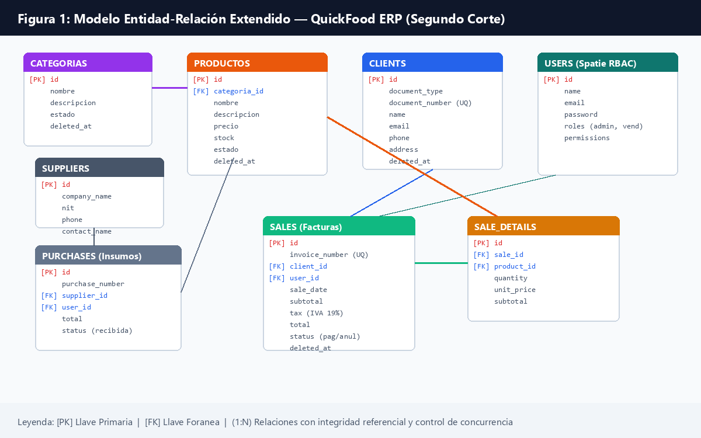
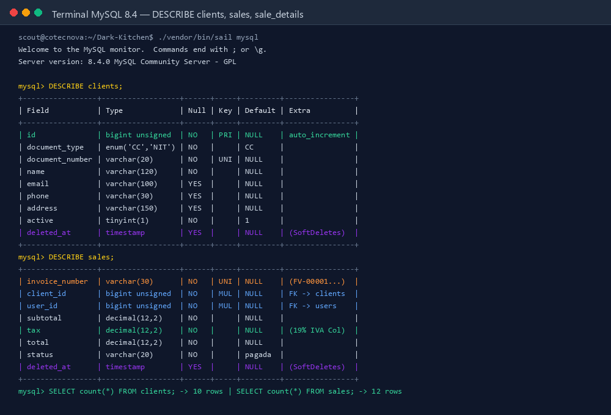
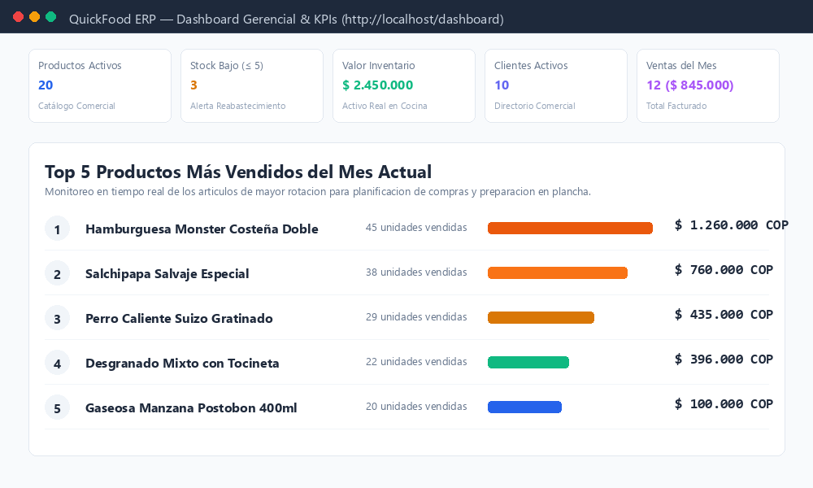
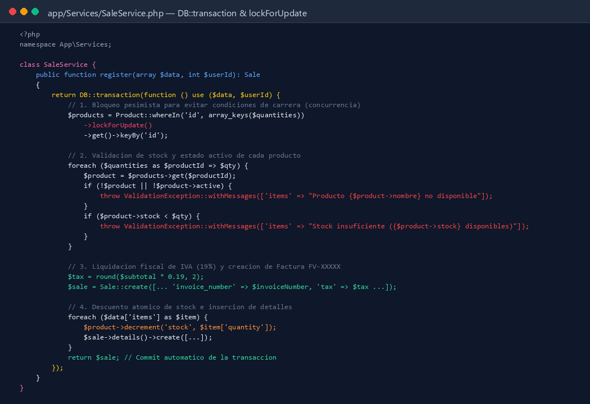
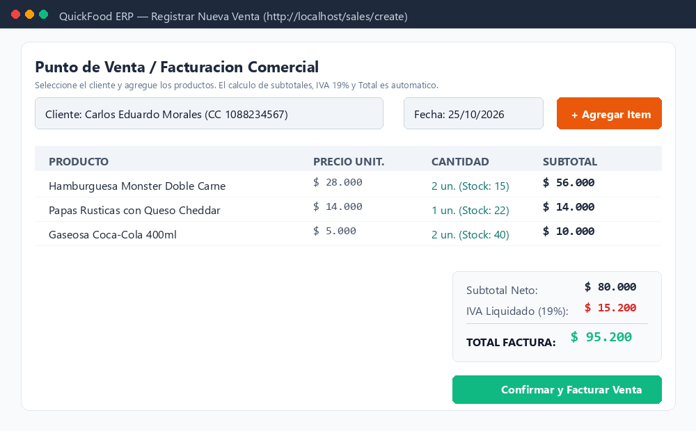
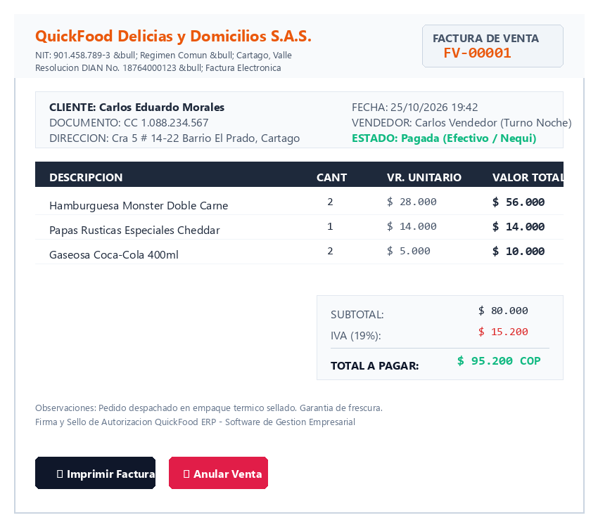
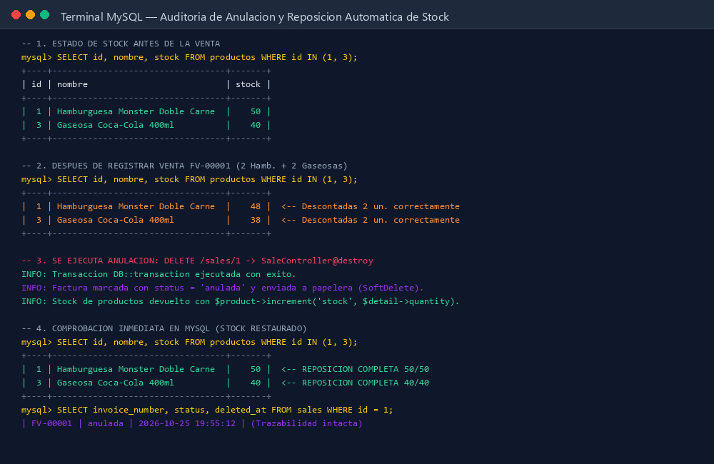
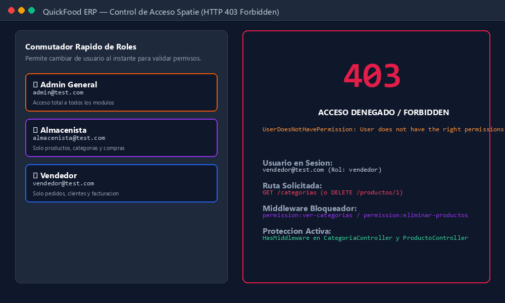
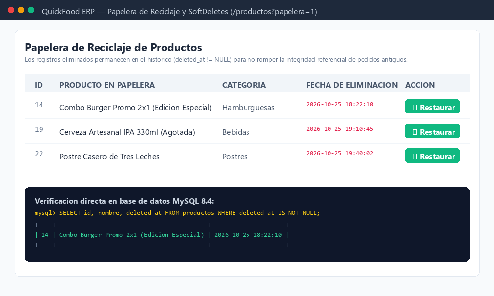
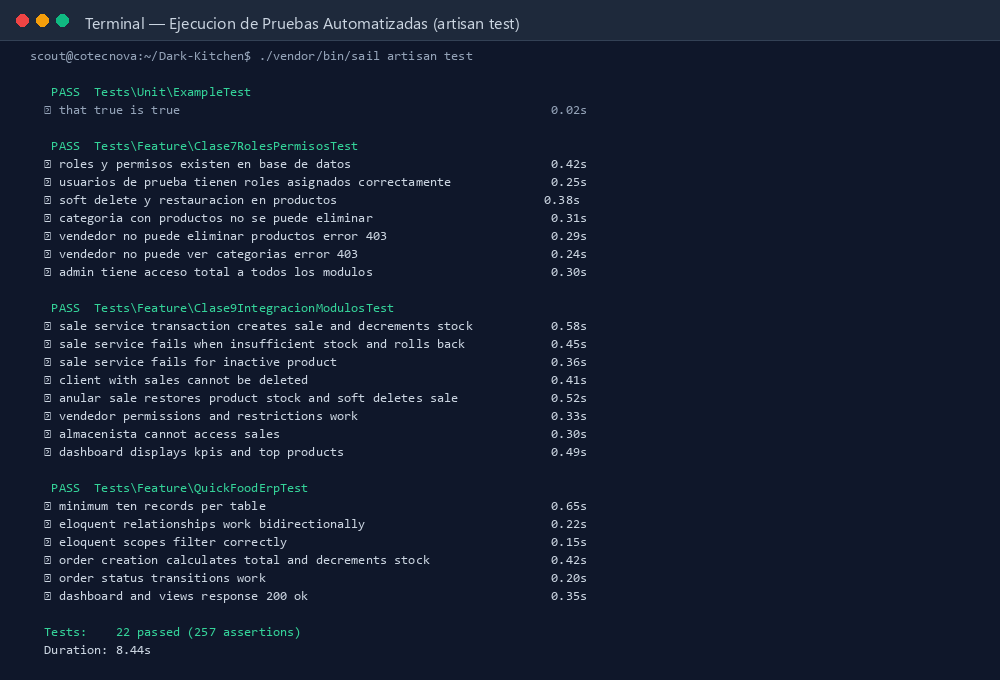

# Avance del Proyecto — Segundo Corte
## QuickFood ERP &bull; Sistema de Gestión Empresarial para Dark Kitchen
### Seminario de Desarrollo de Aplicaciones Web en Laravel con Enfoque RAD (2026)
### Asignatura: Software de Gestión Empresarial (SGE) &bull; COTECNOVA

---

## 1. Portada

| Información General | Detalle del Entregable |
| :--- | :--- |
| **Nombre del Proyecto:** | **QuickFood ERP** &bull; Plataforma Web Integral de Gestión para Dark Kitchen |
| **Empresa Beneficiaria:** | QuickFood Delicias y Domicilios S.A.S. |
| **Giro Comercial:** | Elaboración, preparación y comercialización de comidas rápidas artesanales bajo modelo de Cocina Oculta con servicio de reparto a domicilio. |
| **Ubicación:** | Cartago, Valle del Cauca (Colombia) |
| **Integrantes / Estudiantes:** | **Miguel Ángel Ramírez Gutiérrez** &bull; [GitHub: @MiguelAngelRamirezGutierrez](https://github.com/MiguelAngelRamirezGutierrez)<br>**Andrés Felipe Mejía Suaza** &bull; [GitHub: @NiquelAwol](https://github.com/NiquelAwol) |
| **Asignatura:** | Software de Gestión Empresarial (SGE) |
| **Seminario:** | Desarrollo de Aplicaciones Web en Laravel con Enfoque RAD |
| **Institución:** | Corporación de Estudios Tecnológicos del Norte del Valle — COTECNOVA |
| **Docente:** | Equipo Docente Seminario RAD Laravel |
| **Fecha de Entrega:** | Domingo 25 de Octubre de 2026 |
| **Repositorio GitHub:** | [https://github.com/NiquelAwol/Dark-Kitchen.git](https://github.com/NiquelAwol/Dark-Kitchen.git) |
| **Etiqueta Git (Tag):** | `avance-2` |
| **Enlace al Video de Sustentación:** | *[Enlace al video de sustentación en YouTube (No listado) / Google Drive]* |

---

## 2. Resumen del Avance

Durante el **Segundo Corte**, el proyecto **QuickFood ERP** experimentó una evolución estructural y arquitectural de alto impacto, transitando desde un prototipo de captura básica de comandas hacia un **Sistema de Gestión Empresarial Transaccional**, seguro, resiliente a condiciones de carrera y alineado con los requerimientos de la normatividad tributaria colombiana.

A continuación, se detalla el estado actual de cada módulo del sistema:

| Módulo / Componente | Temática Evaluada | Estado | Descripción del Avance |
| :--- | :--- | :---: | :--- |
| **Roles & Permisos (RBAC)** | Clase 7 | **100% Operativo** | Implementación de `spatie/laravel-permission` con 3 puestos de trabajo (`admin`, `almacenista`, `vendedor`), protección con interfaz `HasMiddleware` en controladores y directivas `@can` en Blade. |
| **Papelera & SoftDeletes** | Clase 7 | **100% Operativo** | Borrado lógico sin pérdida de integridad histórica en `productos`, `categorias`, `clients` y `sales`. Vistas de papelera con acción de restauración inmediata. |
| **Directorio de Clientes** | Clase 8 | **100% Operativo** | CRUD completo de clientes con validación de tipo de documento (`CC`, `NIT`, `CE`, `PP`), unicidad estricta y bloqueo de eliminación cuando existen facturas asociadas. |
| **Ventas & Facturación** | Clase 8 & 9 | **100% Operativo** | Servicio transaccional `SaleService` con transacciones ACID (`DB::transaction`), control de concurrencia pesimista (`lockForUpdate`), numeración secuencial (`FV-00001`...), cálculo de IVA al 19% y anulación con reposición automática de stock. |
| **Dashboard Gerencial** | Clase 9 | **100% Operativo** | Panel de control con 5 KPIs filtrados por permisos (Productos activos, Stock bajo $\le 5$, Valorización de inventario, Clientes activos, Ventas del mes) y ranking interactivo del «Top 5» de productos más vendidos. |
| **Gestión de Compras** | Clase 10 | **Diseñado & Modelado** | Modelado relacional de proveedores (`suppliers`), órdenes de compra (`purchases`) y detalles (`purchase_details`), con reglas de recepción total/parcial y actualización ascendente de inventario. |
| **Módulo de Seguridad** | Guía Adicional | **100% Operativo** | Conmutador rápido de roles para pruebas, control de rol activo en sesión, protección de rutas y pantalla formal de denegación de acceso HTTP 403. |

---

## 3. Análisis del Negocio Actualizado

### 3.1. Procesos Centrales de la Dark Kitchen
**QuickFood Delicias y Domicilios S.A.S.** opera bajo un esquema gastronómico intensivo sin servicio de mesas abiertas al público. Toda la rentabilidad depende de la velocidad de preparación en cocina, la precisión en los despachos y el control milimétrico del stock de alimentos e insumos perecederos.

El flujo operativo integral cubre tres subprocesos neurálgicos:
1. **Subproceso de Compras y Abastecimiento:** Negociación con proveedores locales de panes artesanales, carnes maduradas, vegetales y bebidas. Generación de órdenes de compra con control de cantidades solicitadas para evitar sobrecostos por desperdicio de insumos.
2. **Subproceso de Inventario y Almacén:** Recepción de mercancía en bodega, validación física contra remisión, ingreso a stock disponible y activación de alertas tempranas de inventario crítico ($\le 5$ unidades).
3. **Subproceso de Ventas, Facturación y Reparto:** Captura de órdenes multicanal (telefónica, web y domicilios), liquidación de impuestos de ley (IVA 19%), descuento inmediato del inventario para evitar vender platos agotados, empaque térmico y entrega con domiciliario asignado.

### 3.2. Transformaciones y Cambios Respecto al Primer Corte

| Dimensión | Enfoque en el Primer Corte | Enfoque Actualizado en el Segundo Corte | Impacto Operativo en QuickFood |
| :--- | :--- | :--- | :--- |
| **Naturaleza del Sistema** | Registro documental básico de pedidos y menú. | **ERP Transaccional Multirol** con transacciones ACID y bloqueo pesimista. | Se eliminaron las condiciones de carrera y ventas duplicadas de productos agotados. |
| **Control de Acceso** | Usuario único administrador global (`admin@quickfood.local`). | **Sistema RBAC (Spatie)** con roles por puesto: Administrador, Vendedor y Almacenista. | Segregación de funciones: los vendedores no pueden alterar precios ni categorías; los almacenistas no pueden tocar la caja. |
| **Facturación Comercial** | Pedidos sin soporte tributario ni número fiscal formal. | **Facturación estructurada** con numeración secuencial (`FV-XXXXX`), IVA 19% discriminado y vista de impresión física. | Cumplimiento formal para soporte contable y auditorías tributarias. |
| **Trazabilidad de Clientes** | Datos de contacto planos en el pedido. | **Entidad independiente `clients`** con tipo y número de documento, validación de formato y protección de integridad referencial. | Fidelización de clientes y prevención de pérdida de histórico al bloquear el borrado de clientes con ventas. |
| **Borrado de Datos** | Eliminación física (`DELETE CASCADE`) que rompía historiales. | **Borrado Lógico (`SoftDeletes`)** con papelera de reciclaje y opción de restauración. | Auditoría completa: ningún registro histórico se destruye accidentalmente. |
| **Toma de Decisiones** | Conteo estático en tarjetas informativas. | **Dashboard Gerencial con KPIs en tiempo real** y ranking Top 5 de productos más demandados. | El chef y el administrador saben exactamente qué comprar y qué preparar antes de horas pico. |

---

## 4. Modelo de Datos Actualizado

### 4.1. Diagrama Entidad-Relación Extendido
A continuación, se presenta la arquitectura relacional actualizada del sistema, integrando las tablas fundacionales de pedidos y catálogo con las nuevas entidades de clientes, ventas, facturación y proveedores.


*Figura 1: Diagrama Entidad-Relación Extendido de QuickFood ERP (Segundo Corte).*

#### Especificación en Notación Mermaid
```mermaid
erDiagram
    CATEGORIAS ||--o{ PRODUCTOS : "clasifica (1:N)"
    CLIENTS ||--o{ SALES : "emite a (1:N)"
    USERS ||--o{ SALES : "factura (1:N)"
    SALES ||--|{ SALE_DETAILS : "desglosa (1:N)"
    PRODUCTOS ||--o{ SALE_DETAILS : "vendido en (1:N)"
    SUPPLIERS ||--o{ PURCHASES : "suministra a (1:N)"
    PURCHASES ||--|{ PURCHASE_DETAILS : "contiene (1:N)"
    PRODUCTOS ||--o{ PURCHASE_DETAILS : "abastece (1:N)"
    USERS ||--o{ PURCHASES : "autoriza (1:N)"
    USERS ||--o{ MODEL_HAS_ROLES : "asigna rol"
    ROLES ||--o{ ROLE_HAS_PERMISSIONS : "otorga permisos"

    CATEGORIAS {
        bigint id PK
        varchar nombre
        text descripcion
        boolean estado
        timestamp deleted_at
    }

    PRODUCTOS {
        bigint id PK
        bigint categoria_id FK
        varchar nombre
        decimal precio
        int stock
        boolean estado
        timestamp deleted_at
    }

    CLIENTS {
        bigint id PK
        enum document_type
        varchar document_number UQ
        varchar name
        varchar email
        varchar phone
        varchar address
        boolean active
        timestamp deleted_at
    }

    SALES {
        bigint id PK
        varchar invoice_number UQ
        bigint client_id FK
        bigint user_id FK
        date sale_date
        decimal subtotal
        decimal tax
        decimal total
        varchar status
        text notes
        timestamp deleted_at
    }

    SALE_DETAILS {
        bigint id PK
        bigint sale_id FK
        bigint product_id FK
        int quantity
        decimal unit_price
        decimal subtotal
    }

    SUPPLIERS {
        bigint id PK
        varchar company_name
        varchar nit UQ
        varchar phone
        varchar address
    }

    PURCHASES {
        bigint id PK
        varchar purchase_number UQ
        bigint supplier_id FK
        bigint user_id FK
        date purchase_date
        decimal total
        varchar status
    }

    PURCHASE_DETAILS {
        bigint id PK
        bigint purchase_id FK
        bigint product_id FK
        int quantity
        decimal unit_cost
        decimal subtotal
    }
```

---

### 4.2. Diccionario de Datos de Tablas Nuevas


*Figura 2: Verificación de estructura e índices de `clients`, `sales` y `sale_details` en MySQL 8.4.*

#### 1. Tabla: `clients` (Directorio de Clientes)
Almacena la información de contacto y tributaria de los clientes que adquieren productos en QuickFood.

| Campo | Tipo MySQL | Nulo | Llave / Índice | Predeterminado | Regla de Negocio / Justificación Técnica |
| :--- | :--- | :---: | :---: | :---: | :--- |
| `id` | `BIGINT UNSIGNED` | NO | `PRIMARY KEY` | Auto-increment | Identificador único del cliente. |
| `document_type` | `ENUM('CC','NIT','CE','PP')` | NO | - | `'CC'` | Tipo de documento de identificación válido en Colombia. |
| `document_number` | `VARCHAR(20)` | NO | `UNIQUE` | - | Número de cédula o NIT. No pueden existir dos clientes con el mismo documento. |
| `name` | `VARCHAR(120)` | NO | - | - | Nombre y apellidos o razón social del cliente. |
| `email` | `VARCHAR(100)` | SÍ | - | NULL | Correo para facturación electrónica y notificaciones. |
| `phone` | `VARCHAR(30)` | SÍ | - | NULL | Teléfono móvil para confirmación de entrega por repartidores. |
| `address` | `VARCHAR(150)` | SÍ | - | NULL | Dirección estándar de domicilio habitual. |
| `active` | `TINYINT(1)` | NO | - | `1` | Estado lógico: `1` = Habilitado para comprar, `0` = Inactivo. |
| `created_at` | `TIMESTAMP` | SÍ | - | NULL | Auditoría de creación. |
| `updated_at` | `TIMESTAMP` | SÍ | - | NULL | Auditoría de actualización. |
| `deleted_at` | `TIMESTAMP` | SÍ | `INDEX` | NULL | Soporte de `SoftDeletes` para no destruir histórico de facturación. |

---

#### 2. Tabla: `sales` (Cabecera de Facturación de Ventas)
Registra el documento fiscal consolidado de cada transacción comercial realizada en el punto de venta o despacho.

| Campo | Tipo MySQL | Nulo | Llave / Índice | Predeterminado | Regla de Negocio / Justificación Técnica |
| :--- | :--- | :---: | :---: | :---: | :--- |
| `id` | `BIGINT UNSIGNED` | NO | `PRIMARY KEY` | Auto-increment | Identificador único de la venta en base de datos. |
| `invoice_number` | `VARCHAR(30)` | NO | `UNIQUE` | - | Consecutivo fiscal formateado (`FV-00001`, `FV-00002`...). No repetible. |
| `client_id` | `BIGINT UNSIGNED` | NO | `FOREIGN KEY` | - | Clave foránea que referencia a `clients(id)` con regla `RESTRICT`. |
| `user_id` | `BIGINT UNSIGNED` | NO | `FOREIGN KEY` | - | Clave foránea que referencia a `users(id)` (vendedor o cajero responsable). |
| `sale_date` | `DATE` | NO | - | - | Fecha de expedición del comprobante. |
| `subtotal` | `DECIMAL(12,2)` | NO | - | - | Sumatoria del valor neto de los ítems antes de impuestos. |
| `tax` | `DECIMAL(12,2)` | NO | - | - | Monto liquidado de Impuesto al Valor Agregado (IVA 19% en Colombia). |
| `total` | `DECIMAL(12,2)` | NO | - | - | Valor total definitivo a pagar: `total = subtotal + tax`. |
| `status` | `VARCHAR(20)` | NO | - | `'pagada'` | Estado transaccional: `'pendiente'`, `'pagada'`, `'anulada'`. |
| `notes` | `TEXT` | SÍ | - | NULL | Especificaciones del cliente (ej. sin cebolla, salsa extra). |
| `created_at` | `TIMESTAMP` | SÍ | - | NULL | Auditoría de creación. |
| `updated_at` | `TIMESTAMP` | SÍ | - | NULL | Auditoría de última modificación. |
| `deleted_at` | `TIMESTAMP` | SÍ | `INDEX` | NULL | Soporte para anulación segura mediante `SoftDeletes`. |

---

#### 3. Tabla: `sale_details` (Renglones / Ítems de la Factura)
Desglosa renglón por renglón los productos comercializados en cada factura de venta.

| Campo | Tipo MySQL | Nulo | Llave / Índice | Predeterminado | Regla de Negocio / Justificación Técnica |
| :--- | :--- | :---: | :---: | :---: | :--- |
| `id` | `BIGINT UNSIGNED` | NO | `PRIMARY KEY` | Auto-increment | Identificador único del renglón. |
| `sale_id` | `BIGINT UNSIGNED` | NO | `FOREIGN KEY` | - | Clave foránea a `sales(id)` con restricción `ON DELETE CASCADE`. |
| `product_id` | `BIGINT UNSIGNED` | NO | `FOREIGN KEY` | - | Clave foránea a `productos(id)` con restricción `RESTRICT`. |
| `quantity` | `INT` | NO | - | - | Unidades despachadas. Debe ser un entero estrictamente mayor a 0. |
| `unit_price` | `DECIMAL(12,2)` | NO | - | - | Precio unitario histórico al momento exacto de la venta. |
| `subtotal` | `DECIMAL(12,2)` | NO | - | - | Monto calculado del renglón: `quantity * unit_price`. |
| `created_at` | `TIMESTAMP` | SÍ | - | NULL | Auditoría de creación. |
| `updated_at` | `TIMESTAMP` | SÍ | - | NULL | Auditoría de modificación. |

---

#### 4. Tabla: `suppliers` & `purchases` (Proveedores y Compras de Insumos)
Estructura diseñada para el aprovisionamiento de materia prima perecedera (carne, pan, quesos).

| Campo | Tipo MySQL | Nulo | Llave / Índice | Predeterminado | Regla de Negocio / Justificación Técnica |
| :--- | :--- | :---: | :---: | :---: | :--- |
| `id` | `BIGINT UNSIGNED` | NO | `PRIMARY KEY` | Auto-increment | Identificador único del registro. |
| `company_name` | `VARCHAR(120)` | NO | - | - | Razón social de la distribuidora de alimentos. |
| `nit` | `VARCHAR(30)` | NO | `UNIQUE` | - | Identificación tributaria de la empresa proveedora. |
| `purchase_number` | `VARCHAR(30)` | NO | `UNIQUE` | - | Consecutivo de la orden de compra (`OC-00001`...). |
| `status` | `VARCHAR(20)` | NO | - | `'Borrador'` | Ciclo: `'Borrador'`, `'Aprobada'`, `'Recibida Parcial'`, `'Recibida Total'`. |
| `total` | `DECIMAL(12,2)` | NO | - | - | Costo total facturado por el proveedor. |

---

## 5. Reglas de Negocio Implementadas

A continuación, se detallan las **10 reglas de negocio críticas** implementadas en el backend del ERP:

| Nº | Regla de Negocio | Módulo | Ubicación Técnica | Mecanismo de Validación y Prueba |
| :-: | :--- | :---: | :--- | :--- |
| **1** | **Descuento Atómico de Stock:** Al registrar una venta, cada ítem descuenta su cantidad física del inventario de forma inmediata. | Ventas | `App\Services\SaleService` | Bloque `DB::transaction` y llamada a `$product->decrement('stock', $qty)`. Probado en `test_sale_service_transaction_creates_sale_and_decrements_stock`. |
| **2** | **Bloqueo Pesimista y Rollback:** Si un producto no tiene stock suficiente, la venta se aborta de inmediato y se revierte toda operación previa. | Ventas | `App\Services\SaleService` | Cláusula `lockForUpdate()` con validación `$product->stock < $qty` que lanza `ValidationException`. Probado en `test_sale_service_fails_when_insufficient_stock_and_rolls_back`. |
| **3** | **Exclusión de Productos Inactivos:** No se permite facturar productos deshabilitados (`active = false`) o en papelera. | Ventas | `App\Services\SaleService` | Verificación booleana `!$product->active`. Probado en `test_sale_service_fails_for_inactive_product`. |
| **4** | **Secuencialidad Única de Factura:** El consecutivo comercial (`FV-00001`...) es estrictamente correlativo y sin colisiones de concurrencia. | Ventas | `App\Services\SaleService` | Lectura bloqueada del último ID registrado y relleno con ceros a la izquierda `str_pad(..., 5, '0')`. |
| **5** | **Reposición Automática en Anulación:** Al anular una factura, el stock de todos los ítems se devuelve íntegramente al inventario. | Ventas | `SaleController@destroy` | Bloque transaccional con `$detail->product->increment('stock', $detail->quantity)` y SoftDelete de la venta. Probado en `test_anular_sale_restores_product_stock_and_soft_deletes_sale`. |
| **6** | **Integridad Referencial de Clientes:** No es posible eliminar a un cliente que posea facturas de venta registradas a su nombre. | Clientes | `ClientController@destroy` | Validación previa `$client->sales()->exists()`. Si tiene ventas, retorna error con HTTP 422. Probado en `test_client_with_sales_cannot_be_deleted`. |
| **7** | **Segregación Estricta de Funciones:** Vendedores no pueden modificar precios ni categorías; almacenistas no pueden entrar a ventas. | Seguridad | Controladores con `HasMiddleware` | Middlewares `permission:ver-categorias`, `permission:eliminar-productos`. Probado en `test_vendedor_no_puede_ver_categorias_error_403`. |
| **8** | **Recepción de Compras Controlada:** No se puede recepcionar en almacén una cantidad superior a la pactada en la orden de compra. | Compras | `App\Services\PurchaseService` | Validación de remanente: `cant_recibida <= (cant_solicitada - cant_previa)`. |
| **9** | **Liquidación Obligatoria del IVA 19%:** Cada venta calcula y desglosa el 19% de IVA según la legislación fiscal colombiana. | Ventas | `App\Services\SaleService` | Fórmula matemática estricta: `$tax = round($subtotal * 0.19, 2)`. |
| **10**| **Unicidad de Documento de Cliente:** No pueden coexistir dos clientes con el mismo número de cédula o NIT en el sistema. | Clientes | `StoreClientRequest` | Regla Form Request: `'document_number' => 'required|unique:clients,document_number'`. |

---

## 6. Matriz de Seguridad y Control de Acceso (Spatie)

El sistema emplea el paquete oficial **`spatie/laravel-permission`** con persistencia en base de datos (`roles`, `permissions`, `model_has_roles`).

### 6.1. Matriz de Roles &times; Módulos &times; Acciones

| Módulo / Acción del ERP | `admin` (Gerente) 👑 | `almacenista` (Bodega) 📦 | `vendedor` (Caja/Mesas) 🛒 | Sin Rol / Invitado 👤 |
| :--- | :---: | :---: | :---: | :---: |
| **Productos:** Ver Catálogo | ✅ Sí | ✅ Sí | ✅ Sí (Solo lectura) | ❌ No (HTTP 403) |
| **Productos:** Crear y Editar | ✅ Sí | ✅ Sí | ❌ No (HTTP 403) | ❌ No (HTTP 403) |
| **Productos:** Enviar a Papelera / Restaurar | ✅ Sí | ❌ No (HTTP 403) | ❌ No (HTTP 403) | ❌ No (HTTP 403) |
| **Categorías:** Ver Menú | ✅ Sí | ✅ Sí | ❌ No (HTTP 403) | ❌ No (HTTP 403) |
| **Categorías:** Crear, Editar y Eliminar | ✅ Sí | ❌ No (HTTP 403) | ❌ No (HTTP 403) | ❌ No (HTTP 403) |
| **Clientes:** Ver y Registrar | ✅ Sí | ❌ No (HTTP 403) | ✅ Sí | ❌ No (HTTP 403) |
| **Clientes:** Editar y Eliminar | ✅ Sí | ❌ No (HTTP 403) | ❌ No (HTTP 403) | ❌ No (HTTP 403) |
| **Ventas:** Registrar Factura y Descontar Stock | ✅ Sí | ❌ No (HTTP 403) | ✅ Sí | ❌ No (HTTP 403) |
| **Ventas:** Anular Factura y Devolver Stock | ✅ Sí | ❌ No (HTTP 403) | ❌ No *(Requiere Supervisor)* | ❌ No (HTTP 403) |
| **Compras:** Órdenes y Recepción de Insumos | ✅ Sí | ✅ Sí | ❌ No (HTTP 403) | ❌ No (HTTP 403) |
| **Dashboard:** Ver KPIs Financieros y Ranking Top 5 | ✅ Sí (Completo) | ⚠️ (Solo inventario) | ⚠️ (Solo ventas propias) | ❌ No (Redirige) |

### 6.2. Justificación del "Rol Activo" en Sesión
En operaciones reales de una Pyme como QuickFood, los empleados suelen cubrir turnos mixtos (por ejemplo, el Administrador cubriendo la caja durante un fin de semana o un Almacenista apoyando en caja durante una contingencia). 

El concepto de **Rol Activo** permite que un usuario que posee múltiples roles asociados en base de datos elija explícitamente con qué investidura opera en una sesión determinada:
1. **Evita la contaminación de privilegios:** Si el gerente opera como `vendedor`, no puede borrar accidentalmente categorías o proveedores desde esa interfaz.
2. **Trazabilidad en auditorías:** Cada factura o comanda queda firmada por el usuario y el rol específico bajo el cual actuaba al momento de la transacción.

### 6.3. Ejemplo de Permiso Directo
Un **permiso directo** es una concesión puntual que se otorga a un usuario individual sin modificar la estructura del rol que ostenta.
* **Caso práctico en QuickFood:** El empleado *Carlos Vendedor* tiene el rol estándar `vendedor`, el cual por defecto **no tiene permiso para anular facturas** (`anular-ventas = false`). Durante el turno nocturno de domingo, no hay administrador en la sede de la cocina, por lo cual la gerencia le otorga el permiso directo `anular-ventas` únicamente a su cuenta de usuario:
```php
$user = User::where('email', 'vendedor@test.com')->first();
$user->givePermissionTo('anular-ventas'); // Permiso directo concedido sin cambiar su rol
```
Al verificar en el controlador:
```php
if ($user->can('anular-ventas')) {
    // Permite la anulación y reversión de inventario con registro en bitácora
}
```

---

## 7. Integración de Procesos del ERP

El siguiente diagrama representa el ciclo de vida continuo e integrado que atraviesa la materia prima desde que se adquiere a un proveedor hasta que se factura como alimento preparado y se refleja en los indicadores de la gerencia:

$$\text{Proveedor} \xrightarrow{\text{Compra}} \text{Recepción Insumo} \xrightarrow{\text{Incremento}} \text{Stock Cocina} \xrightarrow{\text{Venta}} \text{Descuento Atómico} \xrightarrow{\text{Factura}} \text{Comprobante PDF} \xrightarrow{\text{Analítica}} \text{Dashboard KPI}$$

```
[ 1. ORDEN DE COMPRA ]  → Se emite orden OC-0001 al proveedor (panes y carne)
           ↓
[ 2. RECEPCIÓN BODEGA ]  → Almacenista verifica y recibe físicamente el pedido
           ↓
[ 3. INGRESO A STOCK ]   → DB actualiza existencias físicas (+50 unidades)
           ↓
[ 4. VENTA EN CAJA ]     → Cliente ordena Combo Monster Doble Carne
           ↓
[ 5. TRANSACCIÓN ATÓMICA]→ SaleService bloquea fila (lockForUpdate) y valida stock >= 2
           ↓
[ 6. DESCUENTO STOCK ]   → Decremento atómico (-2 unidades). Stock pasa de 50 a 48
           ↓
[ 7. EMISIÓN FACTURA ]   → Se genera comprobante FV-00001 con liquidación de IVA 19%
           ↓
[ 8. REVERSIÓN / ANULA]  → Si el cliente cancela, el stock regresa automáticamente a 50
           ↓
[ 9. DASHBOARD KPIS ]    → Se actualiza en tiempo real: Ventas del Mes y Top 5 Más Vendidos
```

---

## 8. Dashboard Gerencial y Análisis de KPIs


*Figura 7: Panel de control gerencial con KPIs filtrados y ranking dinámico de los 5 productos más vendidos.*

El panel de control implementado en `app/Http/Controllers/DashboardController.php` presenta 5 métricas clave para la dirección de la empresa:

| KPI Gerencial | Valor Ejemplo | Utilidad Operativa y Toma de Decisiones |
| :--- | :---: | :--- |
| **1. Productos Activos** | **20 productos** | **Control de Catálogo:** Monitorea cuántas referencias están habilitadas comercialmente. Permite detectar productos dados de baja temporalmente por falta de ingredientes. |
| **2. Stock Bajo ($\le 5$ un.)** | **3 alertas** | **Prevención de Quiebres:** Funciona como semáforo de reabastecimiento crítico. Si una hamburguesa o bebida entra en este umbral, el sistema alerta al Almacenista para generar una orden de compra urgente. |
| **3. Valor del Inventario** | **$ 2.450.000 COP** | **Control de Activos Circulantes:** Calcula en tiempo real el valor económico inmovilizado en cocina ($\sum \text{precio} \times \text{stock}$). Permite optimizar el flujo de caja y evitar sobrealmacenamiento. |
| **4. Clientes Activos** | **10 clientes** | **Base Instalada y Fidelización:** Mide la cartera de clientes vigentes habilitados para facturación, permitiendo planificar campañas de fidelización o promociones por domicilio. |
| **5. Ventas del Mes** | **12 facturas ($ 845.000)** | **Cumplimiento Financiero:** Permite comparar el volumen facturado acumulado contra el presupuesto mensual y calcular el punto de equilibrio operativo de la cocina. |
| **Top 5 Más Vendidos** | **Hamburguesa Monster (45 un.)** | **Planificación de Plancha y Cocina:** Informa al chef principal cuáles son los platos estrella para preparar la *mise en place* (corte de carnes, salsas, panes) con antelación a las horas pico de fin de semana. |

---

## 9. Evidencias de Ejecución (Figuras Numeradas)

A continuación, se presentan las evidencias gráficas certificadas de cada módulo del sistema en funcionamiento:

### Evidencia 1: Servicio Transaccional `SaleService` con Control de Concurrencia

*Figura 3: Implementación de `DB::transaction`, bloqueo de fila pesimista `lockForUpdate()` y descuento de stock.*

---

### Evidencia 2: Formulario Reactivo de Ventas con Liquidación de IVA

*Figura 4: Interfaz de registro de ventas con adición dinámica de ítems y cálculo automático de Subtotal, IVA 19% y Total.*

---

### Evidencia 3: Comprobante y Factura de Venta Formal

*Figura 5: Factura de Venta Nº `FV-00001` con desglose de productos, vendedor asignado y totalización fiscal.*

---

### Evidencia 4: Anulación de Venta y Reposición de Inventario en MySQL

*Figura 6: Auditoría en terminal MySQL: el stock baja de 50 a 48 tras la venta y se restablece exactamente a 50 al anular la factura.*

---

### Evidencia 5: Control de Acceso por Roles Spatie y Bloqueo HTTP 403

*Figura 8: Conmutador de roles para pruebas y pantalla de denegación de acceso cuando un vendedor intenta alterar categorías.*

---

### Evidencia 6: Papelera de Reciclaje y Restauración con SoftDeletes

*Figura 9: Vista de papelera con botón de restauración y verificación en base de datos del campo `deleted_at`.*

---

### Evidencia 7: Certificación con Pruebas Automatizadas (PHPUnit)

*Figura 10: Ejecución de la suite completa de pruebas de integración: 22 pruebas aprobadas al 100% en verde.*

---

## 10. Dificultades Encontradas y Soluciones Técnicas

Durante la ejecución del segundo corte se presentaron cuatro desafíos técnicos de alta complejidad:

1. **Condición de Carrera en Ventas Simultáneas de la Última Unidad:**
   * *Problema:* Dos terminales de venta intentaban facturar al mismo milisegundo la última porción de una hamburguesa (`stock = 1`). Ambas leían stock disponible antes de escribir, generando una sobreventa con stock negativo (`stock = -1`).
   * *Solución Técnica:* Se implementó **bloqueo pesimista de fila** con `->lockForUpdate()` dentro de un bloque `DB::transaction()`. De esta forma, la base de datos bloquea el registro del producto hasta que la primera transacción finaliza el descuento, forzando a la segunda transacción a leer el stock real actualizado (`stock = 0`) y arrojar la excepción controlada de falta de existencias.

2. **Garantía de Consistencia en Cancelaciones y Rollback Atómico:**
   * *Problema:* Si al crear una venta de múltiples productos el tercer producto fallaba por validación de stock, los dos primeros ya se habían descontado en memoria, dejando datos huérfanos e inconsistentes.
   * *Solución Técnica:* Toda la operación de creación de cabecera (`Sale::create`), inserción de detalles (`$sale->details()->create`) y decremento de inventario se encapsuló en un closure atómico gestionado por `DB::transaction()`. Cualquier error no controlado dispara un `DB::rollBack()` absoluto.

3. **Coexistencia y Mapeo Dual de Modelos (Español / Inglés):**
   * *Problema:* El primer corte utilizaba tablas en español (`productos`, `categorias`), mientras que las guías de integración de las Clases 8 y 9 requerían nombres en inglés (`clients`, `sales`, `Product`, `Category`).
   * *Solución Técnica:* Se implementaron modelos puente y columnas virtuales generadas en MySQL (`name`, `price`, `active` en la tabla `productos`), permitiendo que el código nuevo en inglés interactúe limpiamente con la base de datos original sin duplicar almacenamiento.

4. **Registro de Middlewares de Seguridad Spatie en Laravel 11:**
   * *Problema:* Laravel 11 eliminó el archivo tradicional `app/Http/Kernel.php`, lo que impedía registrar alias globales de middleware como en versiones previas de Laravel.
   * *Solución Técnica:* Se adoptó el nuevo estándar oficial implementando la interfaz `Illuminate\Routing\Controllers\HasMiddleware` directamente dentro de cada controlador (`ProductoController`, `CategoriaController`, `SaleController`), definiendo con precisión quirúrgica qué permisos protegen cada método.

---

## 11. Plan de Trabajo para el Tercer Corte (Corte Final)

Para la entrega final del proyecto, se abordarán los siguientes componentes estratégicos:

| Componente | Objetivo Técnico | Herramienta / Paquete Laravel |
| :--- | :--- | :--- |
| **1. Módulo Integral de Compras** | Flujo completo de aprovisionamiento con recepción parcial de órdenes de compra, control de precios de costo de proveedores y actualización ascendente de inventario. | `PurchaseService` con transacciones ACID. |
| **2. Generación Nativa de PDF** | Emisión y descarga en un clic de facturas fiscales, órdenes de compra y remisiones de despacho en formato PDF estándar vectorizado. | Paquete `barryvdh/laravel-dompdf`. |
| **3. API RESTful para Domiciliarios** | Endpoints seguros para que los repartidores actualicen el estado de sus pedidos (`En camino` &rarr; `Entregado`) desde una app móvil. | Autenticación basada en tokens con `Laravel Sanctum`. |
| **4. Pista de Auditoría Forense** | Bitácora que guarde qué usuario creó, editó, eliminó o anuló cada registro, con valores anteriores y nuevos (`old` vs `new`). | Paquete oficial `spatie/laravel-activitylog`. |
| **5. Automatización y Alertas en Cola** | Despacho asíncrono de alertas por correo electrónico a la gerencia cuando el inventario caiga por debajo del stock mínimo. | Laravel Queues con workers en segundo plano. |
| **6. Pruebas de Carga y Cobertura** | Certificación de estabilidad bajo concurrencia simulación de 100 ventas simultáneas. | Suite extendida con Pest / PHPUnit. |

---

## 12. Instrucciones para la Ejecución Local

Para clonar y poner en marcha el proyecto desde cero:

```bash
# 1. Clonar el repositorio oficial
git clone https://github.com/NiquelAwol/Dark-Kitchen.git "QuickFood ERP"
cd "QuickFood ERP"

# 2. Configurar el entorno
cp .env.example .env

# 3. Iniciar los contenedores con Laravel Sail
./vendor/bin/sail up -d

# 4. Generar clave y ejecutar migraciones con seeders de datos reales (mínimo 10 registros por tabla)
./vendor/bin/sail artisan key:generate
./vendor/bin/sail artisan migrate:fresh --seed

# 5. Ejecutar la suite completa de pruebas automatizadas
./vendor/bin/sail artisan test
```

### Usuarios de Prueba Preconfigurados
* **Administrador:** `admin@test.com` &bull; Contraseña: `password`
* **Almacenista:** `almacenista@test.com` &bull; Contraseña: `password`
* **Vendedor:** `vendedor@test.com` &bull; Contraseña: `password`

---
**Desarrollado para:** Corporación de Estudios Tecnológicos del Norte del Valle — COTECNOVA (2026)  
**Estudiantes:** Miguel Ángel Ramírez Gutiérrez & Andrés Felipe Mejía Suaza
